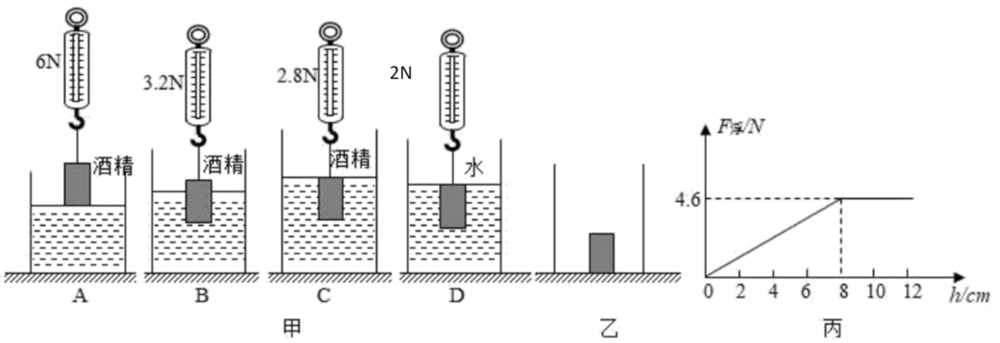

# Physics - 题目 1341

**ID**: 84426e32661f4f4ba72c7ea0bf708996
**年级**: Grade 8
**难度**: Medium
**题型**: Experiment

## 题目
小华用一个弹簧测力计、一个圆柱体、两个底面积均为200cm^{2}的薄壁烧杯（分别装有一定量的酒精和水），对浸在液体中的物体所受的浮力进行探究，其中C、D分别是圆柱体刚好浸没在酒精和水中的情况。​​​​​​​‌如图甲表示探究过程及有关数据。（酒精密度为0.8×10^{3}kg/m^{3}，g=l0N/kg）（1）实验中使用弹簧测力计测量拉力前，应将测力计处于方向将指针调至“0”刻度线上。（2）比较图甲中A、B、C的数据，可以得出浮力的大小与有关。（3）如图甲中D所示，圆柱体浸没在水中所受的浮力是N。（4）如图乙所示，完成实验后，小华将烧杯中水倒出，将该圆柱体放在烧杯底部，然后向烧杯倒入另一种液体，圆柱体受到的浮力F_{浮}与容器内液体的深度关系如图丙所示，圆柱体始终处于沉底状态，则该圆柱体的底面积为m^{2}；未倒液体前圆柱体对容器底部的压强为Pa，液体的密度为kg/m^{3}。

## 解答

1. （1）重力的方向是竖直向下，要测量重力需要将测力计处于竖直方向将指针调至“0”刻度线上。
2. （2）比较图甲中A、B、C的数据知，物体浸入酒精中的体积不同，即排开液体的体积不同，弹簧测力计的示数不同，浮力不同，可以得出浮力的大小与排开液体的体积有关。
3. （3）如图甲中AD所示，圆柱体浸没在水中所受的浮力
4. F_{浮}=G-F=6N-2N=4N
5. （4）空气中弹簧测力计的示数G=6N，完全浸没在酒精中弹簧测力计的示数为2.8N，则圆柱体受的浮力
6. F_{浮}=G-F=6N-2.8N=3.2N
7. 根据F_{浮}=ρ_{液}gV_{排}知圆柱体的体积为
8. V=V_{排}= $\frac {F{{}_{浮}}}{ρ{{}_{酒精}}g}=\frac {3.2{\rm{N}}}{0.8\times 10{^{3}}{\rm{k}}{\rm{g}}{\rm{/}}{\rm{m}}{^{{\rm{3}}}}\times 10{\rm{N}}{\rm{/}}{\rm{k}}{\rm{g}}}=4\times 10{^{-4}}{\rm{m}}{^{3}}$
9. 将该圆柱体放在烧杯底部，然后向烧杯中倒另一种液体，液体深度增至8cm以后，浮力不再变化，说明圆柱体的高度为8cm，圆柱体的底面积为
10. $S=\frac {V}{h}=\frac {4\times 10{^{-4}}{\rm{m}}{^{3}}}{0.08{\rm{m}}}=5\times 10{^{{\rm{-}}3}}{\rm{m}}{^{{\rm{2}}}}$
11. 未倒液体前圆柱体对容器底部的压强为
12. $p=\frac {F}{S}=\frac {G}{S}=\frac {6{\rm{N}}}{0.005{\rm{m}}{^{2}}}=1.2\times 10{^{3}}{\rm{P}}{\rm{a}}$
13. 液体的密度为
14. $ρ{{}_{液}}=\frac {F{{}_{浮液}}}{gV}=\frac {4.6{\rm{N}}}{10{\rm{N}}{\rm{/}}{\rm{k}}{\rm{g}}\times 4\times 10{^{-4}}{\rm{m}}{^{3}}}=1.15\times 10{^{3}}{\rm{k}}{\rm{g}}{\rm{/}}{\rm{m}}{^{3}}$

## 知识点

**中文**:
  - 实验探究阿基米德原理

**English**:
  - Experiment: Investigating Archimedes' Principle

---
