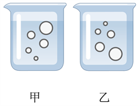

# Physics - 题目 1360

**ID**: 86e1433e5caf40dbbbf2b813e8a374b7
**年级**: Grade 8
**难度**: Medium
**题型**: Experiment

## 题目
在“观察水的沸腾”实验中，某实验小组记录的数据如下表所示：时间（min）…56789101112…温度（℃）…9193979898989898…（1）从记录的数据可知，水沸腾时的温度是℃；（2）同学们在不同时刻观察到水中气泡上升的情况如图甲、乙所示，则图可能是水在沸腾时的情况；（3）沸腾时，杯口附近出现大量“白气”是形成的；（4）实验得到的结论与水在标准大气压下的沸点100℃有明显的差异，其原因可能是：。​​​​​​​‌

## 解答

1. （1）[1]根据表中数据可知，当温度到达98℃时，继续吸热，但温度不变，所以该温度即为沸点，即98℃。
2. （2）[2]甲图气泡在上升过程中气泡体积增大，所以是沸腾时的情况；乙图气泡在上升过程中，体积逐渐减小，所以是沸腾前的情况。
3. （3）[3]沸腾时，杯口附近出现大量“白气”是热的水蒸气遇到冷的空气液化形成的。
4. （4）[4]因为沸点随气压的增大而增大，而一个标准大气压下水的沸点为100℃，所以实验时，当地气压小于一个标准大气压。

## 知识点

**中文**:
  - 探究水的沸腾实验

**English**:
  - Experiment: Boiling of Water

---
