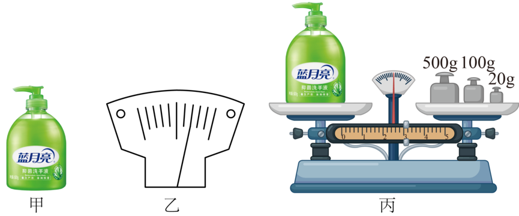

# Physics - 题目 1980

**ID**: 87959332c9f54ce78141804ac96c38d0
**年级**: Grade 8
**难度**: Medium
**题型**: Experiment

## 题目
某洗手液含有75%的酒精，如图所示。​​​​​​​‌小明在疫情期间居家利用网课余暇时间对此洗手液的密度进行了测量。（1）将天平放在上，将游码移至标尺左端的零刻度线处，此时指针位置如图所示，应向调节平衡螺母直至天平平衡；（2）小明将一瓶新的洗手液放入天平的左盘中，如图所示，其质量为g；（3）小明将该品牌的洗手液空瓶装入等高的水，测量的总质量为523g；（4）该洗手液的密度为kg/m^{3}；（5）早起时小明使用后将瓶盖拧下，观察还剩下一半的液体，下午时发现忘记盖上瓶盖。小华对剩余部分洗手液的密度重新进行了测量，测量结果比上面的结果（选填“大”“不变”“小”“不确定”），原因是。

## 解答

1. （1）[1][2]使用天平测量物体质量时，应将天平放在水平工作台上，再将游码移到零刻度线，最后调节平衡螺母使指针指在分度盘中央。游码归零后，指针如图乙所示偏向右边，说明天平右端下沉，应将平衡螺母向左调节使天平平衡。
2. （2）[3]由图丙可知，标尺上分度值为0.2g，游码在3g处，则洗手液和空瓶的质量
3. m_{洗手液}=500g+100g+20g+3g=623g
4. （4）[4]由图甲可知，该瓶的净含量为500mL，合500cm^{3}；将该品牌的洗手液空瓶装入等高的水，测量的总质量为523g；故水的体积为500cm^{3}，由 $ρ=\frac {m}{V}$ 可得装入水的质量
5. $m{{}_{水}}=ρ{{}_{水}}V=1{\rm{g}}{\rm{/}}{\rm{c}}{\rm{m}}{{}^{3}}\times 500{\rm{c}}{\rm{m}}{{}^{3}}=500{\rm{g}}$
6. 则空瓶的质量
7. m_{瓶}=523g-500g=23g
8. 则洗手液的质量
9. m_{洗手液}=623g-23g=600g
10. 洗手液的密度
11. $ρ{{}_{洗手液}}=\frac {m{{}_{洗手液}}}{V}=\frac {600{\rm{g}}}{500{\rm{c}}{\rm{m}}{{}^{3}}}=1.2{\rm{g}}{\rm{/}}{\rm{c}}{\rm{m}}{{}^{3}}=1.2\times 10{{}^{3}}{\rm{k}}{\rm{g}}{\rm{/}}{\rm{m}}{{}^{3}}$
12. （5）[5][6]使用后将瓶盖拧下，观察还剩下一半的液体，下午时发现忘记盖上瓶盖，由于酒精具有挥发性，导致质量小于原来的一半，体积为原来的一半，根据密度公式可知，测得的密度将变小。

## 知识点

**中文**:
  - 液体密度的测量实验

**English**:
  - Experiment: Measuring Density of Liquids

---
