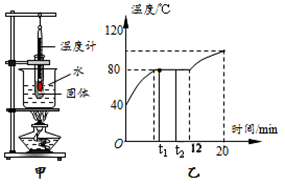
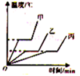

# Physics - 题目 2571

**ID**: 8c1af3c392d34aa5aca3ed2a73955d34
**年级**: Grade 8
**难度**: Medium
**题型**: Experiment

## 题目
如图甲是“探究某种固体物质熔化特点”的实验装置，图乙是根据实验数据描绘出的该物质在熔化过程中温度随时间变化的图象．（1）实验中，所用温度计是根据液体的性质制成的，除了如图所示的器材，还需要一个重要的测量仪器是，用烧杯中的热水加热试管中固体物质，好处是．；​​​​​​​‌（2）由图乙可知，该物质是（选填“晶体”或“非晶体”），熔点是℃．在t2时处于状态．这点时间中，该固体（需要/不需要）吸热；（3）探究固体熔化温度随时间变化的规律时，发现固体熔化太快，没有找到固体的熔点，若要延长固体熔化的时间，请你写出一条可行的办法．（4）如下图所示图象时甲、乙、丙三个物体的熔化图象，其中有两个物体属于同一种物质，用同样的酒精灯对它们加热，由图可知和是同一种物质，而且的质量大．

## 解答

1. （2）该物质在熔化过程中，吸收热量，温度保持在80℃不变，所以该物质为晶体，熔点是80℃；在t_{2}时处于熔化过程中，因此是固液共存状态，这点时间中，该固体需要吸热；
2. （3）固体熔化太快，说明吸收的热量太快了或自身的质量太少了，故可以减慢吸热的速度，可以将酒精灯火焰调小；若固体太少，也会熔化的太快，此时可以增加固体的质量；
3. （4）由图象知，乙和丙的熔点相等，所以为同种物质；在同样加热的情况下，乙和丙吸收的热量相等，丙温度升高较慢，则说明丙的质量较大．

## 知识点

**中文**:
  - 熔化和凝固的探究实验

**English**:
  - Experiment: Melting and Solidification

---
