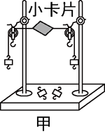
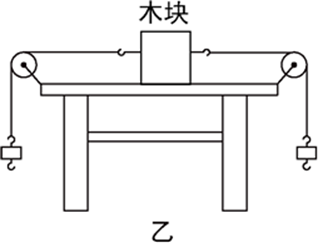

# Physics - 题目 2165

**ID**: 8fb4b849a7fd425fb589385251afe953
**年级**: Grade 8
**难度**: Medium
**题型**: Experiment

## 题目
如图甲是小明同学探究二力平衡条件时的实验情景。​​​​​​​‌（1）小明在实验中选择小卡片的目的是为了忽略小卡片的对实验的影响；（2）要验证不在“同一直线的力”是否平衡，实验中的操作是将小卡片（选填“翻转”或“扭转”），松手后观察小卡片是否平衡；（3）当小卡片处于平衡状态时，若用剪刀将小卡片剪成两半，再观察两半小卡片是否平衡，这样做是为了验证二力平衡时两个力必须作用在；（4）在探究同一问题时，小华将木块放在水平桌面上，设计了如图乙所示的实验，老师认为还是小明的方案更好，小华的方案存在的缺陷是对实验的影响较大。

## 解答

1. （1）[1]选用小卡片做实验，可以减小实验物体的质量，从而减小物体的重力对实验的影响。
2. （2）[2]要探究不在同一直线上的力是否平衡，可让力不作用在同一直线上，那么扭转小卡片，即可让其受到的水平方向的两个拉力的作用不在同一直线上，松手后观察小卡片的状态，便可验证出结论。
3. （3）[3]小卡片本是一个整体，将其剪成两半，即分成了两个物体，而此时拉力便作用在两个物体上，观察此时卡片的运动情意，是为了二力平衡时，两个力必须作用在同一物体上。
4. （4）[4]小明的方案比小华的好，原因是：小华的方案中，木块受到的摩擦力较大，这个摩擦力对实验的影响较大，会影响实验结果。

## 知识点

**中文**:
  - 二力平衡条件的探究实验

**English**:
  - Experiment: Conditions for Two-Force Equilibrium

---
