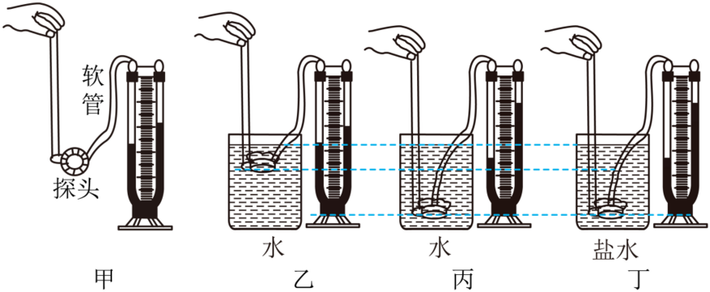
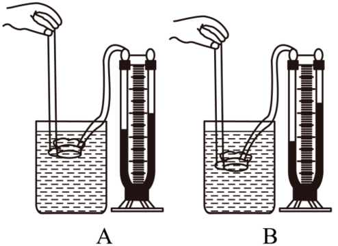

# Physics - 题目 115

**ID**: 904dd29a59774ce6b3ecc0b4215f0114
**年级**: Grade 8
**难度**: Medium
**题型**: Experiment

## 题目
如图是物理爱好者方方同学“探究液体的压强与哪些因素有关”的实验装置。​​​​​​​‌（1）该实验是通过U形管两侧液面的来反映被测液体压强大小的，这里主要用到的研究方法是（选填“控制变量法”、“等效替代法”或“转换法”）；（2）比较两组实验可知，液体内部压强随液体深度的增大而增大；比较丙、丁两组实验可知，液体内部压强与液体的有关：（3）如果保持图乙实验中探头浸在液体中深度不变，将橡皮膜朝向不同方向，U形管两侧液面的高度差不变。说明：在同种液体中，同一深度处向各个方向的压强大小（选填“相等”或“不相等”）；（4）在实验中，方方同学发现探头在图乙所处位置太浅时，U形管两侧液面高度差不太明显，若把U形管中的水换成酒精，保持探头在图乙中的位置不变，则U形管两侧的液面高度差将（选填“增大”、“减小”或“不变”）；（5）完成上述实验后，老师要求方方同学将桌面上两杯没有标签的清水和盐水区分开。于是他将压强计的探头先后浸入到两杯液体中，如图A和B所示，他发现图B中U形管两边的液柱高度差更大，于是认为图B杯中盛的是盐水。你认为他的结论（选填“可靠”或“不可靠”），理由是。

## 解答

1. （1）液体内部压强不易直接观察，当探头橡皮膜上受到压力时，U形管两侧液面出现变化，故可以利用U形管两侧液面的高度差来间接反映被测液体压强的大小，这里主要用到的研究方法是转换法。
2. （2）探究液体内部压强与深度的关系，根据控制变量法，应保持液体的密度和探头的方向不变，改变深度，故比较乙、丙两组实验可知，液体内部压强随液体深度的增大而增大。
3. 比较丙、丁两组实验可知，探头在液体的深度与方向相同，液体的密度不同，根据控制变量法，可知探究的是液体内部压强与液体的密度有关。
4. （3）在实验中，U形管两侧液面的高度差间接反映被测液体压强大小，如果U形管两侧液面的高度差不变，表明此时液面内部压强相同，故可以得出结论，在同种液体中，同一深度处向各个方向的压强大小相等。
5. （4）在实验中， U形管两侧液面高度差产生的压强等于探头处受到的液体的压强，若把U形管中的水换成酒精，保持探头在图乙中的位置不变，即压强不变，液体的密度变小，根据 $p=ρgh$ 可知，则U形管两侧的液面高度差将增大。
6. （5）如图A和B所示，探头在两杯液体中深度不同，而液体压强与深度和密度均有关，图B中U形管两边的液柱高度差更大，只表明在B中探头处压强更大，并不能说明图B杯中盛的是盐水，故他的结论不可靠。

## 知识点

**中文**:
  - 探究液体压强的特点实验

**English**:
  - Experiment: Characteristics of Liquid Pressure

---
