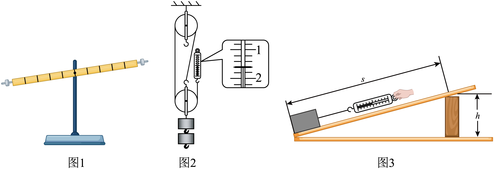

# Physics - 题目 2739

**ID**: 93545d070f2c4121b30b10f5d41ab218
**年级**: Grade 8
**难度**: Medium
**题型**: Experiment

## 题目
在生活和生产中，简单机械有着十分重要的作用。​​​​​​​‌（1）为了探究“杠杆的平衡条件”，小明用图1的装置进行实验。实验前，杠杆左端下沉，应将右端的平衡螺母向调节（选填“左”或“右”），使杠杆在水平位置平衡，目的是便于测量；（2）小明用图2的实验装置探究滑轮组机械效率。实验中用同一滑轮组提升钩码，记录数据如表。实验次数物重G/N物体上升高度h/cm测力计的示数F/N测力计移动的距离s/cm1431.69246183481.624①实验时沿竖直方向拉绳子自由端最省力，且应拉动弹簧测力计。由图2可知，第2次实验中弹簧测力计示数为N；②分析实验数据可得：同一滑轮组，提升的物体越重，滑轮组的机械效率越高。若提升同一物体时，减小动滑轮的重力，则滑轮组的机械效率（选填“变大”、“变小”或“不变”）；（3）小明用图3的实验装置探究斜面的机械效率。发现斜面的机械效率与斜面的倾斜程度和摩擦有关，与物重无关。保持斜面倾斜程度不变，可以采用的方法减小摩擦，从而提高斜面的机械效率。某次实验测得物重G＝4N、斜面长s＝1m、高h＝0.2m，若机械效率η＝80%，则物体在斜面上受到的摩擦力为N。

## 解答

1. （1）[1][2]杠杆静止时，杠杆左端下沉，右端偏高，平衡螺母需向右调节，直到杠杆在水平位置平衡，目的是便于测量力臂的大小。
2. （2）①[3][4]实验中应匀速直线拉动弹簧测力计，使挂在动滑轮下的钩码缓缓上升，此时测力计的示数等于绳端拉力；由图2知，测力计的分度值为0.2N，其示数为1.6N。
3. ②[5]由表中三次实验数据知，同一滑轮组，提升的物体越重，滑轮组的机械效率越高；若提升同一物体时，减小动滑轮的重力，相同情况下所做额外功减小，所以滑轮组的机械效率变大。
4. （3）[6][7]保持斜面倾斜程度不变，可以采用减小接触面的粗糙程度的方法减小摩擦，从而提高斜面的机械效率。利用斜面做的有用功
5. $W{{}_{有\prime }}＝Gh＝{\rm{4}}{\rm{N}}\times {\rm{0}}{\rm{.}}{\rm{2}}{\rm{m}}＝{\rm{0}}{\rm{.}}{\rm{8}}{\rm{J}}$
6. 总功为
7. $W{{}_{总}}\prime ＝\frac {W\prime {{}_{有}}}{η}{\rm{=}}\frac {{\rm{0}}{\rm{.}}{\rm{8}}{\rm{J}}}{{\rm{8}}{\rm{0}}{\rm{\%}}}{\rm{=}}{\rm{1}}{\rm{J}}$
8. 克服摩擦做的额外功
9. $W{{}_{额}}＝W{{}_{总}}^{′}-W{{}_{有}}^{′}＝{\rm{1}}{\rm{J}}-{\rm{0}}{\rm{.}}{\rm{8}}{\rm{J}}＝{\rm{0}}{\rm{.}}{\rm{2}}{\rm{J}}$
10. 物体在斜面上受到的摩擦力
11. $f＝\frac {W{{}_{额}}}{s}=\frac {{\rm{0}}{\rm{.}}{\rm{2}}{\rm{J}}}{{\rm{1}}{\rm{m}}}{\rm{=}}{\rm{0}}{\rm{.}}{\rm{2}}{\rm{N}}$

## 知识点

**中文**:
  - 探究杠杆的平衡条件实验
  - 滑轮（组）的机械效率的测量实验
  - 斜面机械效率的测量实验

**English**:
  - Experiment: Equilibrium Conditions of Levers
  - Experiment: Measuring Mechanical Efficiency of Pulleys
  - Experiment: Measuring Mechanical Efficiency of Inclined Planes

---
