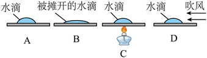

# Physics - 题目 2978

**ID**: 9355390695184443baad90d31132b9d3
**年级**: Grade 8
**难度**: Medium
**题型**: Experiment

## 题目
为探究影响液体蒸发快慢的因素，小凡同学在4块相同的玻璃板上各滴一滴质量相同的水，进行如图所示的实验探究：（1）通过两图的对比，可以得出水蒸发快慢与水的温度有关。​​​​​​​‌（2）通过两图的对比，液体蒸发快慢可能跟液体表面空气流动快慢有关。（3）通过AB两图的对比，液体蒸发快慢可能跟有关。（4）生活中液体蒸发的现象，晒衣服时要将衣服展开并放在阳光下，其目的是。

## 解答

1. （2）[2]要研究液体蒸发快慢跟液体表面空气流动快慢是否有关，需控制液体的温度及表面积的大小相同，液体表面空气流动快慢不同，符合条件的是A和D。
2. （3）[3]通过AB两图的对比，可以知道两图的液体的温度，液体表面空气流动都相同，液体表面积不同，故可以研究液体蒸发快慢跟液体表面积的大小是否有关。
3. （4）[4]晒衣服时为何需要将衣服展开并放在阳光下，原因有两个，一是展开是为了增大液体的表面积；二是阳光下是为了提高液体的温度，都能加快液体的蒸发。

## 知识点

**中文**:
  - 探究影响蒸发快慢的因素

**English**:
  - Experiment: Factors Affecting Evaporation

---
