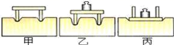

# Physics - 题目 2373

**ID**: 98aee83f9e5046ca80387a1b017b8647
**年级**: Grade 8
**难度**: Medium
**题型**: Experiment

## 题目
在探究“压力的作用效果跟什么因素有关”的实验中，小明同学用一块海绵、一张小桌子和一个砝码，做了如图所示的一系列实验，请注意观察、分析，并回答下列问题：（1）实验中小明是通过比较海绵的程度来确定压力作用效果的大小；​​​​​​​‌（2）分析比较图甲、乙的实验现象，乙图中小桌子上加砝码的目的是为了（选填“增大”或“减小”）压力大小；可以得出结论：当相同时，压力越大，压力的作用效果越明显；（3）分析比较图乙、丙的实验现象，丙图中小桌子倒放的目的是为了（选填“增大”或“减小”）受力面积大小；可以得出结论：当相同时，受力面积越小，压力的作用效果越明显．

## 解答

1. （1）实验中小明是通过比较海绵的凹陷程度来确定压力作用效果的大小；
2. （2）分析比较图甲、乙的实验现象，乙图中小桌子上加砝码的目的是为了增大压力大小；可以得出结论：当受力面积相同时，压力越大，压力的作用效果越明显；
3. （3）分析比较图乙、丙的实验现象，丙图中小桌子倒放的目的是为了增大受力面积大小；可以得出结论：当压力大小相同时，受力面积越小，压力的作用效果越明显．

## 知识点

**中文**:
  - 探究影响压力作用效果因素的实验

**English**:
  - Experiment: Factors Affecting Pressure Effect

---
