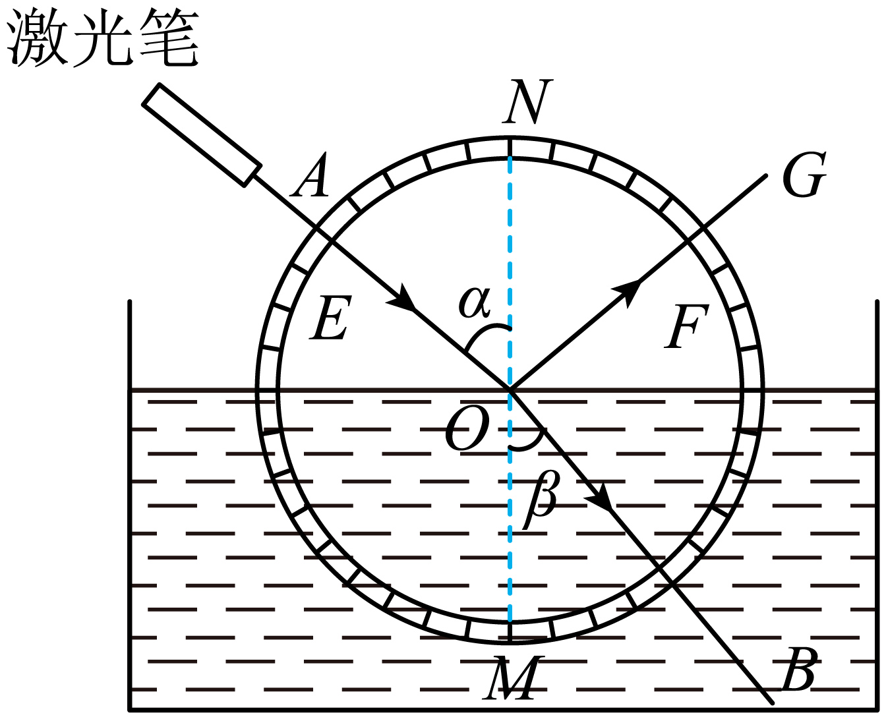

# Physics - 题目 2879

**ID**: 9913bac24e2e44e5876e4c2ec96db127
**年级**: Grade 8
**难度**: Medium
**题型**: Experiment

## 题目
如图是小宇“探究光的反射与折射规律”的实验装置。​​​​​​​‌通过多次实验得到下表数据：入射角0°15°30°45°60°反射角0°15°30°45°60°折射角0°11°22°32°40°（1）多次实验表明：在光的反射过程中，反射角（选填“大于”“小于”或“等于”）入射角；当光从空气斜射入水中时，折射角随入射角的增大而（选填“增大”“减小”或“不变”）；（2）小宇让一束光沿着图中BO方向入射向水面时，发现光线沿着OA方向折射进入空气，这表明：光的折射现象中，光路是的；（3）小宇接着又完成了光从空气斜射进玻璃和从玻璃斜射入空气的实验，他这样进行多次实验的目的是为了。

## 解答

1. （1）由表格中的数据可知，在光的反射现象中，反射角始终等于入射角。
2. 当光从空气斜射入水中时，折射角小于入射角，随着入射角的增大，折射角也在增大。
3. （2）让一束光沿着图中BO方向入射向水面时，发现光线沿着OA方向折射进入空气，因为在光的折射现象中，光路是可逆的。
4. （3）换用不同的介质多次实验的目的是避免偶然性，使实验结论更具有普遍性。

## 知识点

**中文**:
  - 光的折射规律的探究实验
  - 探究光的反射定律

**English**:
  - Investigation: Law of Refraction
  - Investigation: Law of Reflection

---
