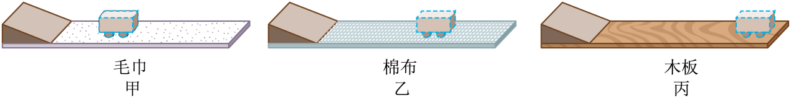

# Physics - 题目 1196

**ID**: a3105183f3f84626834793c9dbd99fe9
**年级**: Grade 8
**难度**: Medium
**题型**: Experiment

## 题目
小宇利用如图所示的实验装置探究阻力对物体运动的影响。​​​​​​​‌。（1）如图所示，每次使小车从同一斜面的（选填“相同”或“不同”）高度由静止滑下，目的是让小车到达水平面时的速度相同；（2）观察小车在毛巾、棉布、木板表面滑行的距离，发现小车在表面滑行的距离最远，说明小车在此表面受到的阻力最小，速度减小得最慢。由此推理，若水平面绝对光滑，小车运动时不受阻力，它将做，这种实验方法属于，说明物体的运动（选填“需要”或“不需要”）力来维持；

## 解答

1. （1）根据控制变量法，实验中为了控制小车每次滑到水平面时的速度相同，同一斜面的相同高度由静止滑下。
2. （2）由图甲、乙、丙可知，小车在毛巾表面上滑行的距离最近，在棉布表面滑行的距离较远，在木板上滑行的距离最远，说明小车在木板表面受到的阻力最小，速度减小得最慢。
3. 据此推理：若水平面绝对光滑，小车运动时不受阻力，它将运动的无限远，即做匀速直线运动，说明物体的运动不需要力来维持，这种实验方法是科学推理法。

## 知识点

**中文**:
  - 阻力对物体运动影响的探究实验

**English**:
  - Experiment: Effect of Resistance on Motion

---
