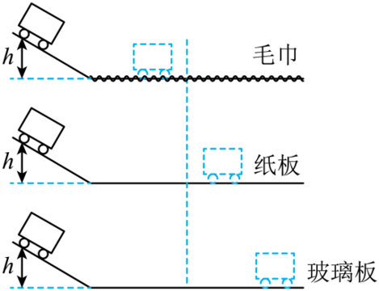

# Physics - 题目 2666

**ID**: a4bddfa759704720ba0aff89fc1372c3
**年级**: Grade 8
**难度**: Medium
**题型**: Experiment

## 题目
某同学利用斜面、小车、毛巾、纸板和玻璃板进行了三次实验。​​​​​​​‌实验中，让小车从同一斜面的同一高度由静止自由滑下，分别通过铺有毛巾、纸板和玻璃板的水平面，运动一段距离后停在如图所示的三个位置。（1）小车从同一斜面的同一高度由静止自由滑下，到达水平面上时具有相同的动能，小车获得的动能是由（选填“重力势能”或“弹性势能”）转化而来的；（2）从实验中可以看到，在同样条件下，水平面对小车的阻力越小，小车前进得越（选填“远”或“近”）；（3）由三次实验的现象并进一步推理得出：如果水平面绝对光滑，运动的小车不受任何阻力的作用时，将做运动。

## 解答

1. （1）让同一小车从同一斜面的同一高度由静止滑下，质量不变，高度减小，速度增大，重力势能减小，动能增大，重力势能转化为动能，小车到达水平面时具有相同的速度，到达水平面的动能相同。
2. （2）在同样条件下，水平面对小车的阻力越小，小车运动的距离越远，小车速度减小得越慢。
3. （3）进一步推理得出，在水平面上运动的小车，如果不受阻力，小车的速度不再减小，它将做匀速直线运动。

## 知识点

**中文**:
  - 阻力对物体运动影响的探究实验

**English**:
  - Experiment: Effect of Resistance on Motion

---
