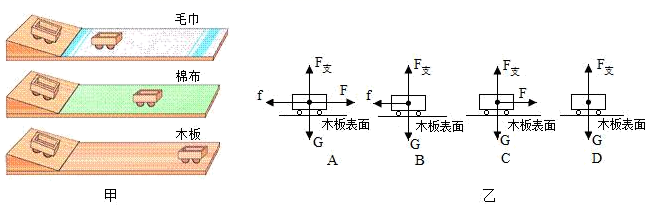

# Physics - 题目 2469

**ID**: a6b797216ed14417b948bfc39cb79d80
**年级**: Grade 8
**难度**: Medium
**题型**: Experiment

## 题目
物理兴趣小组在“探究阻力对物体运动的影响”的实验中，让小车从同一斜面的同一高度由静止白由滑下，分别通过平铺在水平面上的毛巾、棉布、木板表面，如图甲所示。​​​​​​​‌（1）图乙是对在水平面上运动小车进行的受力分析，其中正确的是；（2）小车在相同斜面顶端由静止释放，是为了使小车到达水平面时的相同；（3）由实验现象可知：表面粗糙程度越小，小车受到阻力越小滑动距离越远，小车速度减小的越；（4）实验中，小车在棉布、木板表面克服阻力做功的功率分别是P_{1}、P_{2}，则P_{1}P_{2}（选填“＞”、“＝”或“＜”）；（5）本实验中小车在水平面上三次运动过程中消耗的机械能大小（选填“相等”或“不相等”）。

## 解答

1. （1）小车在水平面上做减速运动，受非平衡力的作用，在竖直方向上受重力和支持力，在水平方向上只受水平向左的摩擦力，故B图正确。
2. （2）实验中，每次都让小车从同一个斜面的相同位置由静止开始滑下，是为了使小车到达斜面底端时具有相同的速度。
3. （3）分析图中内容可知，木板表面最光滑，小车运动时受到的阻力最小，其运动的距离最远，故可得出结论：水平面越光滑，小车受到的阻力越小，小车前进的距离越远，速度减小得越慢。
4. （4）因小车达到水平面时初速度相同，小车的动能相同，最终速度为0，小车的动能全部转化为内能，大小等于克服阻力做的功，故小车在棉布、木板表面上克服阻力做功相等，即W_{1}＝W_{2}；但在木板表面滑行时间长，根据P＝ $\frac {W}{t}$ 知木板表面功率小，棉布表面功率大，即则P_{1}＞P_{2}；
5. （5）因小车到达水平面时的初速度相同，故在水平面上开始的动能相同，最后速度为0，动能为0，故本实验中小车在水平面上三次运动过程中消耗的机械能大小相等。

## 知识点

**中文**:
  - 阻力对物体运动影响的探究实验

**English**:
  - Experiment: Effect of Resistance on Motion

---
