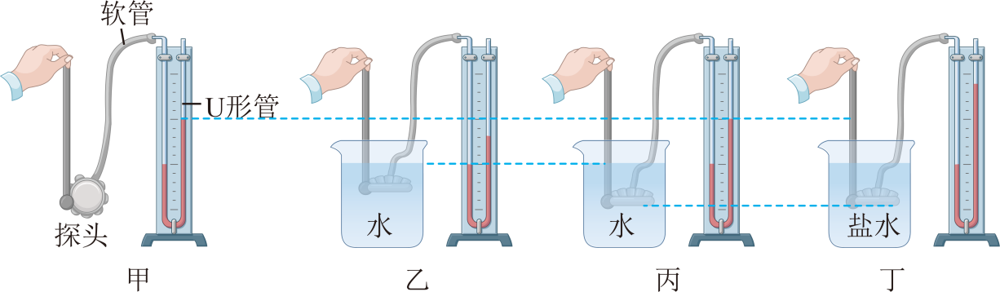

# Physics - 题目 1410

**ID**: aa9065675fd5478ab8f50b105f59193b
**年级**: Grade 8
**难度**: Medium
**题型**: Experiment

## 题目
如图所示是用压强计探究“影响液体内部压强大小因素”的实验装置。​​​​​​​‌（1）实验前发现U形管两侧液面存在高度差，接下来的操作是；（2）实验中液体内部压强的大小是通过观察U形管两侧液面的来反映；（3）比较图乙和丙，可以得到：液体的压强与有关；（4）比较两图，可以得到：液体的压强与液体密度有关；（5）在同种液体中，探头距液面的距离相同时，只改变探头的方向，U形管两边液柱的高度差（选填“不变”或“变化”）。表明在同种液体中，距液面的距离相同时，液体内部向各个方向压强的大小。

## 解答

1. （1）实验前发现U形管两侧液面存在高度差，只需要将软管取下，再重新安装，这样的话，U形管中两管上方的气体压强就是相等的（都等于大气压），当橡皮膜没有受到压强时，U形管中的液面就是相平的。
2. （2）液体内部压强大小通过U形管两侧液面高度差的大小来反映，这是转换法。
3. （3）分析图丙、乙两图的实验现象，同种液体，丙图中深度较大，U形管两侧液面的高度差较大，液体压强较大，可以得到液体的压强与液体密度有关，同种液体中，液体深度越深，液体的压强越大。
4. （4）探究液体压强和液体的密度的关系，保持探头的深度相同，液体的密度不同，所以比较丙、丁两图，可以得到液体压强与液体密度有关。
5. （5）探头距液面的距离相同时，深度相同，只改变探头的方向，U形管两边液柱的高度差不变，说明在同一液体的同一深度，液体内部向各个方向的压强相等。

## 知识点

**中文**:
  - 探究液体压强的特点实验

**English**:
  - Experiment: Characteristics of Liquid Pressure

---
