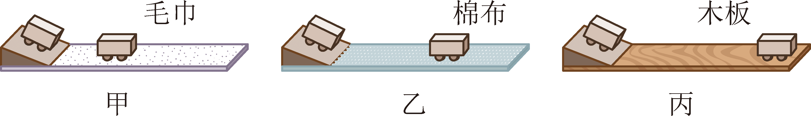
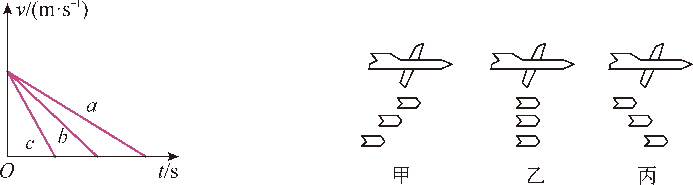

# Physics - 题目 965

**ID**: aad95ac96bf64abd835552790428963d
**年级**: Grade 8
**难度**: Medium
**题型**: Experiment

## 题目
小刘用斜面、木板、毛巾、棉布和小车探究“阻力对物体运动的影响”，如图所示。​​​​​​​‌（1）为了保证三次实验小车到达水平面相同，需要使小车在斜面的同一高度由静止下滑。（2）如图是小车在木板、毛巾、棉布表面上运动时，速度随时间的变化图像，其中表示小车在毛巾上运动的是（选填“a”“b”或“c”）图线。（3）牛顿第一定律在实际生活中有着广泛的应用，一架在空中水平向右匀速直线飞行的飞机上，自由落下了三箱物资。如图所示是物资落地前与飞机位置关系的情景，不计空气对物资的阻力，物资与飞机的位置关系正确的是（选填“甲”“乙”或“丙”）图。

## 解答

1. （1）为了保证三次实验小车到达水平面初速度相同，应让小车从斜面的同一高度由静止滑下，用到了控制变量法。
2. （2）根据图可知， 水平面越粗糙，摩擦阻力越大，小车滑行的距离越远，速度减小得越慢，据此判断毛中上的阻力最大，小车运动的距离最短，速度减小得最快，故属于在毛巾上运动图线的是c。
3. （3）不计空气对物资的阻力，在水平方向上，由于物资具有惯性，仍保持原来的运动状态，所以物资与飞机的速度相等它们相对静止，由图示可知，物资与飞机的位置关系为图乙。

## 知识点

**中文**:
  - 阻力对物体运动影响的探究实验

**English**:
  - Experiment: Effect of Resistance on Motion

---
