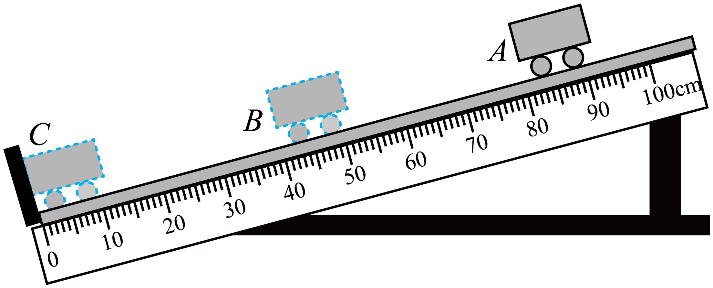

# Physics - 题目 810

**ID**: b2684c0e2fa04f13b464db8306232ef5
**年级**: Grade 8
**难度**: Medium
**题型**: Experiment

## 题目
在如图所示的斜面上测量小车运动的平均速度。​​​​​​​‌（1）测量小车运动的平均速度的实验原理是。（2）要完成实验，除了如图所示器材外还需要的测量器材是。（3）图中 $AC$ 段的路程 $s{{}_{AC}}=$${\rm{c}}{\rm{m}}$ 。（4）将小车从坡顶A处由静止释放，测出小车从A处滑到坡底C处的时间 $t{{}_{1}}=2.6{\rm{s}}$ ；再次将小车从A处由静止释放，测出小车从A处滑到中点B处的时间 $t{{}_{2}}=1.8{\rm{s}}$ ，BC段的平均速度 $v{{}_{BC}}=$${\rm{c}}{\rm{m}}/{\rm{s}}$ 。

## 解答

1. （1）测量平均速度需要使用总路程比上总时间，所以实验的原理是速度公式 $v=\frac {s}{t}$ 。
2. （2）实验中需要测量小车运动的时间和距离，所以还需要的测量工具是秒表和刻度尺。
3. （3）图中 $AC$ 段的路程为 $s{{}_{AC}}={\rm{8}}{\rm{0}}{\rm{.}}{\rm{0}}{\rm{c}}{\rm{m}}{\rm{-}}{\rm{0}}{\rm{.}}{\rm{0}}{\rm{c}}{\rm{m}}{\rm{=}}{\rm{8}}{\rm{0}}{\rm{.}}{\rm{0}}{\rm{c}}{\rm{m}}$ 。
4. （4） $BC$ 段所用时间 $t{{}_{BC}}=t{{}_{1}}-t{{}_{2}}={\rm{2}}{\rm{.}}{\rm{6}}{\rm{s}}{\rm{-}}{\rm{1}}{\rm{.}}{\rm{8}}{\rm{s}}{\rm{=}}{\rm{0}}{\rm{.}}{\rm{8}}{\rm{s}}$ ， $BC$ 段的路程为 $s{{}_{BC}}=40.0{\rm{c}}{\rm{m}}-0.0{\rm{c}}{\rm{m}}={\rm{4}}{\rm{0}}{\rm{.}}{\rm{0}}{\rm{c}}{\rm{m}}$ ， $BC$ 段的平均速度为 $v{{}_{BC}}=\frac {s{{}_{BC}}}{t{{}_{BC}}}=\frac {40.0{\rm{c}}{\rm{m}}}{0.8{\rm{s}}}={\rm{5}}{\rm{0}}{\rm{c}}{\rm{m}}{\rm{/}}{\rm{s}}$ 。

## 知识点

**中文**:
  - 测量物体运动的平均速度

**English**:
  - Measuring Average Velocity of an Object

---
