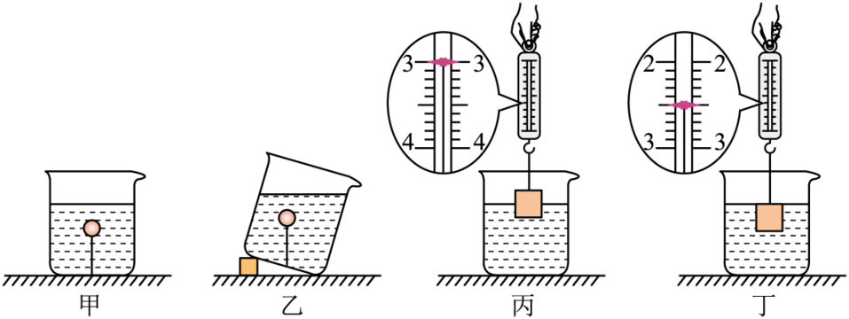

# Physics - 题目 2589

**ID**: b3622629c20b4acd895884bbc03fafa2
**年级**: Grade 8
**难度**: Medium
**题型**: Experiment

## 题目
小明等几位同学设计不同实验探究浮力。​​​​​​​‌（1）他们找了一段较细的红线，将其两端分别固定在乒乓球和大烧杯的底部，再向烧杯缓慢注水，直到水将乒乓球浸没，发现红线在竖直方向被拉直，如图甲所示；然后，将大烧杯倾斜，发现红线仍旧在竖直方向被拉直，如图乙所示。根据两次观察到的现象，可以得出：乒乓球受到的浮力的方向（选填序号）：

## 解答

1. （1）在图甲中，乒乓球受到水的浮力作用，同时受到红线的拉力作用，两者方向相反，由于红线在竖直方向被拉直，说明拉力的方向是竖直向上的，因此浮力的方向也是竖直向上的，与重力的方向相反。在图乙中，当大烧杯倾斜时，红线仍然保持竖直方向被拉直，这说明浮力的方向并没有因为烧杯的倾斜而改变，仍然是竖直向上的。因此，根据两次观察到的现象，我们可以得出结论：乒乓球受到的浮力的方向是竖直向上的，选项B正确。
2. （2）在图丙中，铝块部分浸入水中，此时弹簧测力计的示数为3.0N。根据称重法测浮力的知识，铝块受到的浮力
3. F_{浮}=G−F_{丙}=4.0N−3.0N=1.0N（3）在图丁中，铝块全部浸没在水中，此时弹簧测力计的示数为2.5N。同样根据称重法测浮力的知识，此时铝块受到的浮力
4. F_{浮}′=G−F_{丁}=4.0N−2.5N=1.5N比较两次的浮力大小，当铝块浸在水中的体积增大时（从部分浸入到全部浸没），它受到的浮力也增大。因此，可以得出结论：铝块浸在水中的体积越大，受到的浮力越大。

## 知识点

**中文**:
  - 探究影响浮力大小因素的实验
  - 浮力的方向及产生原因

**English**:
  - Experiment: Factors Affecting Buoyancy
  - Direction and Cause of Buoyancy

---
