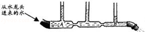
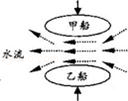

# Physics - 题目 2606

**ID**: bb08578e20d0410ba06e8af460c065a3
**年级**: Grade 8
**难度**: Medium
**题型**: Experiment

## 题目
阅读下面短文，并回答问题：我们已经知道静止液体内部压强的规律，那么，流动着的液体的压强大小又有什么规律呢？我们可以通过下面的实验来研究这个问题打开水龙头，使自来水流过如图所示的玻璃管，可以看到A、B处竖直玻璃管中的液面高度不同，这说明A、B处的压强不相同．是什么原因引起A、B处的压强不相同呢？我们知道，在相同的时间内，流过A、B处的水量是相同的．但是由于B处水管的横截面积比A处小，所以，水在B处的流速一定比在A处的流速大由此可见，A、B处压强不同是由水的流速不同引起的．（1）根据上面的实验现象．可知A、B两处的压强关系是：P_{A}P_{B}，其物理依据是：．（2）请你总结出流动液体压强大小规律：．（3）根据你得到的规律解释下面的现象：如图所示，是两艘并排的船，它们在航行时常常会不自主地碰在一起，这是因为：．​​​​​​​‌

## 解答

1. （1）根据图1的实验现象可以看出A、B两处的水面高度不同，A处高，B处低，依据的公式 $p=ρgh$ 可知，在液体的密度相同时，h越小的，压强越小，故压强小的是图中的B处．
2. （2）由上述现象可知，水从A处向B处流动时，A处流速慢，B处流速快，故可总结出流动液体压强大小的规律是：流速越大的位置压强越小．
3. （3）两艘并排的船，它们在航行时，常常不由自主地碰在一起，这是由于两船之间水的面积小，而两船外侧水的面积大，所以两船之间的水流速度大，压强小，两船外侧水流速度小，压强大，形成向里的压力差，使两船相互靠拢．
4. 故答案为(1). ＞    (2).  $P=ρgh$   (3). 流体流速大压强小    (4). 由于两船之间水的面积小，所以两船之间的水流速大，压强小，而外侧水的面积大，两船外侧的水流速度小，压强大，形成向里的压力差，使两船相互靠拢．
5. 【点睛】解答本题的关键有两点，一是理解液体压强的公式并能用来分析压强的大小，二是熟知流体压强与流速的关系．

## 知识点

**中文**:
  - 流体压强与流速的关系

**English**:
  - Relationship between Fluid Pressure and Flow Speed

---
