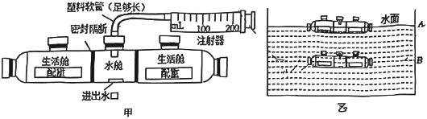

# Physics - 题目 1712

**ID**: c21b7110cdcb417891cdd9b7faa02c12
**年级**: Grade 8
**难度**: Medium
**题型**: 实验探究题：本大题共4小题，共25分。

## 题目
2025年3月7日，我国的“奋斗者”号载人潜水器在马里亚纳海沟10909m的最深处取得重大突破，同学们引以为傲，并针对潜艇的制作，开展项目式学习。​​​​​​​‌【项目设计】项目小组利用硬质塑料瓶制作潜水艇，塑料瓶厚度不计，相邻两舱之间密封不连通，水舱与注射器通过塑料软管相连，推拉注射器活塞可以实现潜水器的浮沉，模型如图甲所示。【产品检测】（1）为使悬浮的潜水艇上浮，应（选填“推”或“拉”）活塞。（2）如图乙所示，重力为G的潜水艇从深度B上浮到深度A，最终在水面保持静止。下列哪个选项是潜水艇所受浮力随时间变化的大致图像。

## 解答

1. （1）为使悬浮的潜水艇上浮，应推活塞排出一定质量的水，以减小潜水艇的自重，使浮力大于重力，合力竖直向上，潜水艇就会上浮。
2. （2）如图乙所示，重力为G的潜水艇从深度B上浮到深度A，最终在水面保持静止。在露出水面之前，排开液体的体积不变，由阿基米德原理，受到的浮力不变，在刚露出水面到漂浮的过程中，排开水的体积变小，受到的浮力变小，最终，浮力等于重力，保持不变，所以浮力先不变，再减小，最后不变，由图可知，C符合题意，A、B、D不符合题意。
3. （3）由题意可知，注射器活塞推到最左端时潜水艇位于水槽底部，此时自重最小，也不能上浮，根据测试结果，对该潜水艇的浮沉情况评价级别是：待改进；潜水艇是根据改变自重来实现浮沉的，其自重过大导致不能上浮，所以改进措施减少配重的质量。
4. （4）要使潜水器实现在水中的悬浮，则浮力应等于潜水器的总重力，该潜水器悬浮时受到的浮力
5. $F{{}_{浮}}=ρ{{}_{水}}gV=1.0\times 10{^{3}}kg/{\rm{m}}{^{3}}\times 10{\rm{N}}/kg\times 650\times 10{^{-6}}{\rm{m}}{^{3}}=6.5{\rm{N}}$
6. 材料的总质量为 $0.5kg$ ，则材料的总重力 $G=mg=0.5kg\times 10{\rm{N}}/kg=5{\rm{N}}$
7. 因该潜水器材料的总重力小于悬浮时的浮力，所以需在水舱内注水，则需注入水的重力 ${\rm{Δ}}G{{}_{水}}=F{{}_{浮}}-G=6.5{\rm{N}}-5{\rm{N}}=1.5{\rm{N}}$
8. 根据阿基米德原理可知需注入水的体积 ${\rm{Δ}}V{{}_{排}}=\frac {{\rm{Δ}}G{{}_{水}}}{ρ{{}_{水}}g}=\frac {1.5{\rm{N}}}{1.0\times 10{^{3}}kg/{\rm{m}}{^{3}}\times 10{\rm{N}}/kg}=1.5\times 10{^{-4}}{\rm{m}}{^{3}}=150cm{^{3}}=150{\rm mL}$
9. 注射器的容积最小应大于150mL。

## 知识点

**中文**:
  - 物体的浮沉条件及其应用
  - 阿基米德原理的应用

**English**:
  - Floating/Sinking Conditions and Applications
  - Applications of Archimedes' Principle

---
