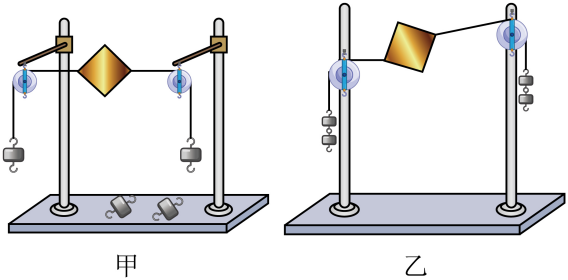

# Physics - 题目 2981

**ID**: c39b22b8a04d454a801faedd8a0d30ec
**年级**: Grade 8
**难度**: Medium
**题型**: Experiment

## 题目
如图甲所示是创新小组探究“二力平衡条件”时的情景。​​​​​​​‌（1）该小组选用纸卡片而不选用形状相同的铁卡片进行实验，是因为铁卡片受到的较大，会使铁卡片两边拉力不在一条直线上。（2）在实验过程中创新小组通过调整钩码个数来改变纸卡片两边拉力的。（3）为了探究互相平衡的两个力是否在同一直线上，创新小组的琦琦同学用手将纸卡片沿水平方向旋转一个角度后保持静止，此时两端细线对纸卡片的拉力（选填“在”或“不在”）一条直线上。（4）利用图乙装置（不计卡片重力）能不能探究二力平衡的条件？；你判断的理由是：。

## 解答

1. （1）选用纸卡片而不选用形状相同的铁卡片进行实验，是因为铁卡片受到的重力较大，会使铁卡片两边拉力不在一条直线上，影响实验效果。
2. （2）卡片两侧的钩码通过绳子对小卡片施加了两个向相反方向的拉力，拉力的大小等于钩码的重力，钩码的数量越多，拉力就越大，实验时可以通过调整钩码的数量来改变拉力的大小。
3. （3）旋转小卡片，使细线作用在它上面的力不在同一直线上，松手后，小卡片转动最终静止时，两个力在同一直线上。所以实验可以探究平衡力是否在同一直线上。
4. （4）因为左右两侧各通过一个定滑轮，定滑轮的位置虽然不等高，但是当两个力大小相等，方向相反，作用在同一直线上，作用在同一个物体上时，小卡片还是处于静止状态，照样能完成实验。

## 知识点

**中文**:
  - 二力平衡条件的探究实验

**English**:
  - Experiment: Conditions for Two-Force Equilibrium

---
