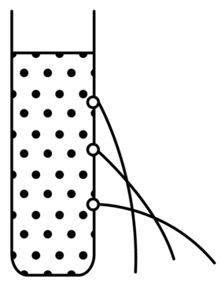

# Physics - 题目 2461

**ID**: c7adf99ffc2a45fbaa9325b01a8c2da9
**年级**: Grade 8
**难度**: Medium
**题型**: Experiment

## 题目
（1）在用海绵、压力小桌、钩码等器材来探究压力的作用效果跟什么有关的实验中，压力的作用效果是通过反映出来的。​​​​​​​‌这种在探究物理问题时常用的表现方法，我们称之为法；（2）将压力小桌分别正放在水平放置的海绵和水平桌面上时，其表面形变明显不同，这时小桌对海绵的压强大小小桌对桌面的压强；（3）在探究液体压强规律的时候，老师为同学们演示了如图所示的实验：将水倒入侧壁开孔的容器中时，会看到水以如图所示的情形喷出。由此我们可以得出：a、液体对有压强。b、液体的压强随增大而变大。

## 解答

1. （1）[1][2]研究的物理量不易直接测量时，都需要想办法把它们的大小间接表示出来，这种方法叫转换法。在用海绵、压力小桌、钩码等器材来探究压力的作用效果跟什么有关的实验中，压力的作用效果是通过观察海绵的凹陷程度反映出来的。这种在探究物理问题时常用的表现方法，我们称之为转换法。
2. （2）[3]将压力小桌分别正放在水平放置的海绵和水平桌面上时，根据压强公式 $p=\frac {F}{S}$ 可知，因压力相同，受力面积也相同，这时小桌对海绵的压强大小等于小桌对桌面的压强。
3. （3）[4][5]由图可知，将水倒入侧壁开孔的容器中时，会看到水以如图所示的情形喷出，说明液体对容器侧壁有压强；且深度越大，液体射出的距离越远，说明液体的压强随深度的增大而变大。

## 知识点

**中文**:
  - 探究影响压力作用效果因素的实验
  - 探究液体压强的特点实验

**English**:
  - Experiment: Factors Affecting Pressure Effect
  - Experiment: Characteristics of Liquid Pressure

---
