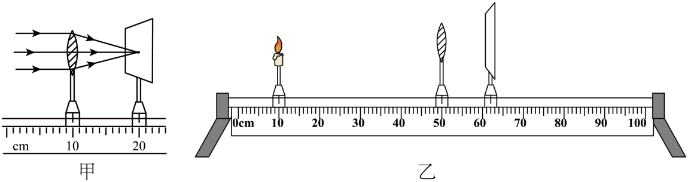

# Physics - 题目 1307

**ID**: c91aff1f3a4b4717b59fd4b1131c5421
**年级**: Grade 8
**难度**: Medium
**题型**: Experiment

## 题目
如图所示是工附物理兴趣小组“探究凸透镜成像规律”的实验装置：（1）首先调整烛焰、凸透镜、光屏三者的中心在同一高度，目的是；（2）如图甲，让平行光正对凸透镜照射，光屏上出现一个最小、最亮的光斑，则凸透镜的焦距 $f=$cm；（3）当蜡烛、凸透镜、光屏在光具座上的位置如图乙时，光屏上成清晰的像，利用止时凸透镜成像的特点制成的光学仪器是（选填“照相机”、“放大镜”或“投影仪”）。​​​​​​​‌若实验过程中保持凸透镜不动，只将蜡烛和光屏的位置对调，则光屏上还会成清晰的像，依据是；若实验过程中挡住凸透镜的一半，像的完整程度（选填“会”或“不会”）受影响；（4）将蜡烛移到35cm处，若想在光屏上得到清晰的像，应将光屏向（选填“左”或“右”）移动，像将（选填“变大”“不变”或“变小”）。

## 解答

1. （1）根据通过凸透镜光心的光线传播方向不变，调整烛焰、凸透镜、光屏三者的中心在同一高度，这样像就能够使像成在光屏的正中央。
2. （2）如图甲，让平行光正对凸透镜照射，光屏上出现一个最小、最亮的光斑，该光斑的位置就是焦点的位置，焦点和光心的距离为焦距，则凸透镜的焦距10.0cm。
3. （3）当蜡烛、凸透镜、光屏在光具座上的位置如图乙时，物距是40.0cm，物距大于两倍的焦距，像距在一倍焦距和两倍焦距之间，成的是倒立的缩小的实像，利用止时凸透镜成像的特点制成的光学仪器是照相机。
4. 依据是光通过凸透镜时，会发生折射，根据光路可逆可知，若实验过程中保持凸透镜不动，只将蜡烛和光屏的位置对调，则光屏上还会成清晰的像。
5. 若实验过程中挡住凸透镜的一半，像的完整程度不会发生变化，光还可以通过凸透镜的另一部分折射成像。
6. （4）将蜡烛移到35cm处，此时的物距为15cm，在一倍焦距和两倍焦距之间，像距需要大于两倍焦距，故若想在光屏上得到清晰的像，应将光屏向右移动；根据凸透镜成像规律可知，物体靠近，像远离，像的大小变大。

## 知识点

**中文**:
  - 凸透镜成像规律的探究实验

**English**:
  - Experiment: Imaging Rules of Convex Lenses

---
