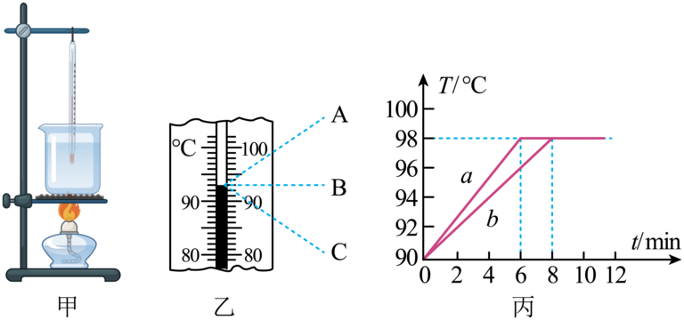

# Physics - 题目 1256

**ID**: d341cd4f44f14f648757c5a0aa14a4b1
**年级**: Grade 8
**难度**: Medium
**题型**: Experiment

## 题目
图甲是探究“水沸腾时温度变化的特点”的实验装置。​​​​​​​‌（1）实验室某一时刻温度计的示数如图乙所示，读数方法正确的是（选填“A”、“B”、或“C”），温度计的示数为℃。（2）沸腾时，水需要不断的，但水的温度保持不变，同时水中会产生大量的气泡，气泡在上升过程中会（选填“变大”、“不变”或“变小”）；（3）两位同学用完全相同的实验装置进行实验，绘制了如图丙所示的水的温度随时间变化的图像，发现水开始沸腾的时间不同，原因是水的不同；完成实验后，撤去酒精灯后，发现烧杯中的水不会马上停止沸腾，其原因是。

## 解答

1. [2]由图乙可知，温度计的分度值为1℃，示数为93℃。
2. （2）[3][4]水沸腾时需要继续吸收热量，但是温度保持不变；水沸腾后，水的表面和内部温度相同，气泡在上升过程中不断有水汽化，进入气泡，因此水沸腾时产生的气泡在上升过程中逐渐变大。
3. （3）[5]水的质量不同，到达沸点所需要吸收的热量不同，同样的加热条件下，质量越大加热的时间越长。
4. [6]完成实验后，撤去酒精灯后，由干烧杯底部的温度高于水的温度，烧杯内的水继续吸收热量，所以烧杯中的水不会马上停止沸腾。

## 知识点

**中文**:
  - 探究水的沸腾实验

**English**:
  - Experiment: Boiling of Water

---
