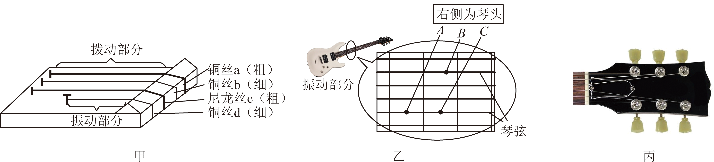

# Physics - 题目 300

**ID**: db195e899bc1497f92395e3e39b0f8d4
**年级**: Grade 8
**难度**: Medium
**题型**: Experiment

## 题目
小和在吉他演奏中发现，琴弦发出声音的音调与弦线的长度、粗细和松紧有关。​​​​​​​‌她的探究过程如下：（1）利用几根弦线进行研究，如图甲所示，其中a、b、c、d四根弦线的松紧相同；a、b、c等长，d较短；a、c等粗，b、d等粗。①小和实验中采用的探究方法是；②若她要研究音调与弦线粗细的关系，则应选择两弦线做实验；③若选择b、d两弦线做实验，则可以探究音调与弦线的关系；（2）得出结论后，小和有所判断，如图乙所示的吉他琴弦，在松紧和材料相同的情况下，分别按住A点、B点、C点后拨动琴弦，使琴弦振动发声，则按住点发出的声音音调最高；（3）如图丙所示，吉他琴头的弦钮连接着琴弦，小和进一步研究发现，通过旋动弦钮改变弦的也可以改变音调。

## 解答

1. （1）实验中采用的探究方法是控制变量法，每次只改变一个因素，控制其他因素不变。
2. 研究音调与弦线粗细的关系，需控制长度、材料、松紧相同，粗细不同，因此选择a和b两弦，a、b等长、等材料、等松紧，粗细不同。
3. 选择b、d两弦，b、d松紧、粗细、材料相同，长度不同，因此研究的是音调与弦线长度的关系。
4. （2）在松紧、材料相同的情况下，弦线越短、越细，振动频率越高，音调越高。图乙中，按住A点时弦线最短、最细，因此发出的声音音调最高。
5. （3）通过旋动弦钮改变弦的松紧程度，改变振动的频率，也可以改变音调。

## 知识点

**中文**:
  - 音调的探究实验

**English**:
  - Experiment: Investigating Pitch

---
