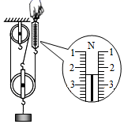

# Physics - 题目 3001

**ID**: dd2cec4579604bc39d9bf274bd3dee55
**年级**: Grade 8
**难度**: Medium
**题型**: Experiment

## 题目
“测滑轮组的机械效率”的实验数据如下表：实验次数物重G（N）物体上升高度h（m）拉力F（N）绳子自由端移动距离s（m）机械效率η140.12.00.366.7%250.10.369.4%360.12.60.3(1)实验时，应沿竖直向上的方向拉动弹簧测力计；(2)第2次实验中弹簧测力计的示数如图所示为N；(3)第3次实验滑轮组的机械效率是；（保留一位小数）(4)如果用这个滑轮组提升7N的重物，则它的机械效率可能是（选填序号）。​​​​​​​‌

## 解答

1. (1)在实验过程中，应沿竖直方向匀速向上拉动弹簧测力计，此时处于平衡状态，受到平衡力的作用，测力计示数才等于拉力大小。
2. (2)由图可知，测力计分度值为0.2N，则第2次实验中弹簧测力计的示数为2.4N。
3. (3)第3次实验滑轮组的机械效率
4. η= $\frac {Gh}{Fs}=\frac {6{\rm{N}}\times 0.1{\rm{m}}}{2.6{\rm{N}}\times 0.3{\rm{m}}}$ ≈77.0%
5. (4)由实验数据可知，用同一滑轮组，提升的物体越重，滑轮组的机械效率越高，所以，使用该滑轮组提升7N的重物，此时物重比第3次实验的物重还大，则此时滑轮组的机械效率大于77.0%，可能为80%，故选C。

## 知识点

**中文**:
  - 滑轮（组）的机械效率的测量实验

**English**:
  - Experiment: Measuring Mechanical Efficiency of Pulleys

---
