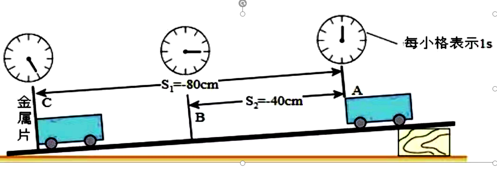

# Physics - 题目 2877

**ID**: dd54f921ddb84675839f1e018ed588e4
**年级**: Grade 8
**难度**: Medium
**题型**: Experiment

## 题目
小宁在“测量小车平均速度”的实验中，设计了如下图所示实验装置：（1）该实验的原理，实验中的测量工具有：停表和；（2）实验中把斜面的坡度放置的较小，这样做的目的是；（3）请根据图中信息回答：全程的平均速度v=m/s。​​​​​​​‌

## 解答

1. （1）平均速度是物体运动总路程与总时间的比值，故该实验的原理 $v=\frac {s}{t}$ 。
2. 测平均速度的原理为实验中必须测量的物理量是路程和时间，所以需用到刻度尺和停表。
3. （2）实验中把斜面的坡度放置的较小，其目的是使小车运动的速度慢一些，方便计时。
4. （3）读图可知s_{1}＝80cm＝0.8m，t_{1}＝5s，则全程的平均速度下半程的路程 $v=\frac {s{{}_{1}}}{t}=\frac {80cm}{5{\rm{s}}}=16cm/{\rm{s}}=0.16{\rm{m}}/{\rm{s}}$

## 知识点

**中文**:
  - 测量物体运动的平均速度

**English**:
  - Measuring Average Velocity of an Object

---
