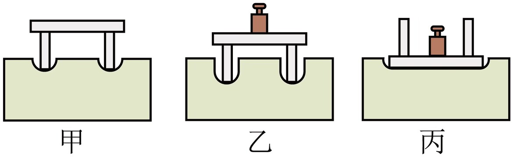

# Physics - 题目 2016

**ID**: df276a10631f41c6a1780079af644e9d
**年级**: Grade 8
**难度**: Medium
**题型**: Experiment

## 题目
在探究“影响压力作用效果的因素”的实验中，某同学进行了如图所示的实验：甲图把小桌放在海绵上；乙图在小桌上放一个砝码；丙图把小桌翻过来，桌面朝下并在它上面放一个砝码。​​​​​​​‌（1）实验中，压力作用效果是通过海绵的来反映的；（2）对比甲和乙，说明相同时，压力越大，压力作用效果越明显；（3）挖掘机不用轮胎而用履带，是两个图示的实验步骤得出的结论在实际生活中的应用。

## 解答

1. （1）根据转换法，本实验通过海绵的凹陷程度来反映压力的作用效果。
2. （2）压力的作用效果与压力的大小和受力面积的大小有关，甲、乙两图中，乙图中压力较大，海绵的凹陷程度较大，因此可知，当受力面积一定时，压力越大，压力的作用效果越明显。
3. （3）挖掘机不用轮胎而用履带，是因为在压力一定时，受力面积越大，压强越小。乙图和丙图中压力大小相同，丙图中受力面积较大，海绵凹陷程度较小，因此挖掘机不用轮胎而用履带，是乙和丙两个图示的实验步骤得出的结论在实际生活中的应用。

## 知识点

**中文**:
  - 探究影响压力作用效果因素的实验

**English**:
  - Experiment: Factors Affecting Pressure Effect

---
