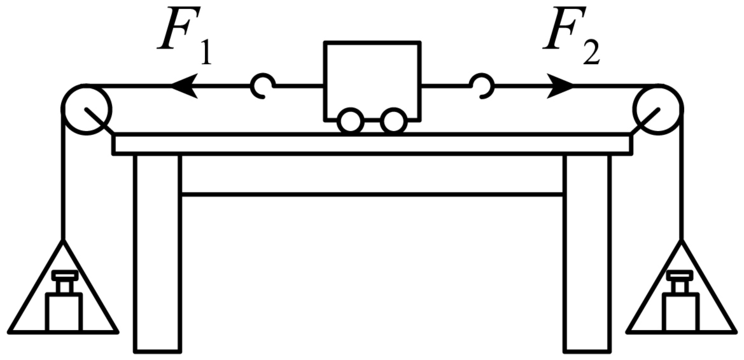

# Physics - 题目 2556

**ID**: e1a71db0e5884465bff46c8d05dae8aa
**年级**: Grade 8
**难度**: Medium
**题型**: Experiment

## 题目
如图是“探究二力平衡条件”的实验装置。​​​​​​​‌（1）实验中，用小车替换木块，是为了减小对实验的影响；（2）向两吊盘中加砝码，当两盘中的砝码质量时，小车静止；（3）在步骤（2）上，将小车在桌面上扭转一个角度，松手后观察到小车（选填“仍能”或“不能”）保持静止、该现象说明两个力必须作用在才能平衡；（4）如果将小车换成一个轻质弹簧测力计，在左右两盘各放入重5N的砝码（不计吊盘、细绳的质量和滑轮摩擦），则弹簧测力计静止时的示数为N。

## 解答

1. （1）实验中，用小车替换木块，是变滑动摩擦力为滚动摩擦力，是为了减小摩擦力对实验的影响。
2. （2）小车在水平面上受到两个水平拉力作用，当两盘砝码相等时，小车受到的拉力相等，小车静止。
3. （3）在步骤（2）中两个拉力大小相等，方向相反，用手把小车在水平桌面上扭转一个角度后，两个拉力则不在一条直线上，释放后，小车不能在此位置平衡。这一步骤的目的是研究二力平衡时，两个力必须满足的条件之一是两个力必须作用在同一直线上。
4. （4）如果将小车换成弹簧测力计，左右两盘各放入重5N的砝码，其受到的拉力还是一对平衡力，其读数应为5N。

## 知识点

**中文**:
  - 二力平衡条件的探究实验

**English**:
  - Experiment: Conditions for Two-Force Equilibrium

---
