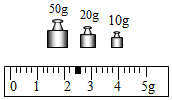

# Physics - 题目 324

**ID**: e5dba1ad96604280b00faef5b853a141
**年级**: Grade 8
**难度**: Medium
**题型**: Experiment

## 题目
现有一瓶饮料，小明用托盘天平、烧杯和已知密度为ρ_{0}的金属块测出了饮料的密度ρ。​​​​​​​‌(1)将天平放在水平台面上，游码移至，调节平衡螺母，直至天平平衡；(2)用天平测出金属块的质量m_{1}，读数如图所示，为g；(3)把金属块放入空烧杯中，往烧杯中倒入适量饮料，使金属块浸没在饮料中，在烧杯液面位置做好标记。测出此时总质量为m_{2}；(4)取出金属块，放在台面上。往烧杯中倒饮料，直至液面到达标记处，测出此时的总质量为m_{3}；(5)ρ=（用符号表示），金属块取出时带走部分饮料，测量结果选填“偏大”“偏小”或“不变”）。

## 解答

1. (1)使用天平时，将天平放在水平台面上，游码移至标尺左端零刻度线处。
2. (2)由图可知，金属块的质量
3. m_{1}=50g+20g+10g+2.4g=82.4g
4. (4)往烧杯中倒饮料，直至液面到达标记处，测出此时瓶和饮料的总质量。
5. (5)金属块的体积
6. V_{金}= $\frac {m{{}_{1}}}{ρ{{}_{0}}}$
7. 往烧杯中倒入饮料的体积
8. V_{饮料}=V_{金}= $\frac {m{{}_{1}}}{ρ{{}_{0}}}$
9. 往烧杯中倒入饮料的质量
10. m_{饮料}=m_{3}+m_{1}-m_{2}
11. 饮料的密度
12. $ρ=\frac {m{{}_{饮料}}}{V{{}_{饮料}}}{\rm{=}}\frac {m{{}_{3}}+m{{}_{1}}-m{{}_{2}}}{\frac {m{{}_{1}}}{ρ{{}_{0}}}}=\frac {m{{}_{3}}+m{{}_{1}}-m{{}_{2}}}{m{{}_{1}}}ρ{{}_{0}}$
13. 金属块取出时带走部分饮料，加入饮料的质量偏大，由 $ρ{\rm{=}}\frac {m}{V}$ 可知饮料的密度会偏大。

## 知识点

**中文**:
  - 液体密度的测量实验

**English**:
  - Experiment: Measuring Density of Liquids

---
