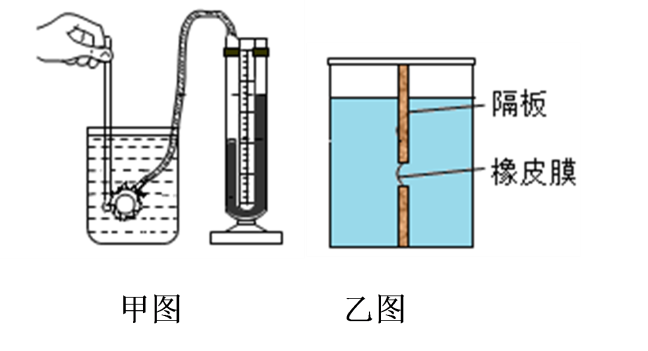

# Physics - 题目 615

**ID**: e7b50b8fff2a440db6b23c693adb8065
**年级**: Grade 8
**难度**: Medium
**题型**: Experiment

## 题目
某同学用下列器材探究“液体内部的压强”。​​​​​​​‌（g取10N/kg）（1）图甲压强计通过U形管两侧液面的来反映橡皮膜所受压强的大小；（2）他把探头放入水面下6cm处，探头受到水的压强是Pa；继续向下移动探头，会看到U形管两侧液面的高度差变大，说明液体内部的压强与液体的有关；（3）为了检验“液体内部的压强与液体密度有关”这一结论，他用图乙的装置，在容器的左右两侧分别装入密度的不同液体，看到橡皮膜向左侧凸起，则（填“左”或“右”）侧液体的密度较大。

## 解答

1. （1）[1]图甲所示的压强计是通过U形管中液面的高度差来反映被测压强大小的，高度差越大，液体压强越大。
2. （2）[2]由 $p=ρgh$ 可知，把探头放入水面下6cm，即0.06m处，探头受到水的压强
3. $p=ρ{{}_{水}}gh{\rm{=}}1.0\times 10{^{3}}{\rm{k}}{\rm{g}}/{\rm{m}}{^{3}}\times 10{\rm{N}}{\rm{/}}{\rm{k}}{\rm{g}}\times 0.06{\rm{m}}{\rm{=}}600{\rm{P}}{\rm{a}}$
4. [3]继续向下移动探头，液体的密度不变，深度变大，观察到U形管两侧液面的高度差变大，说明液体内部的压强与液体的深度有关。
5. （3）[4]由图乙可知，橡皮膜向左侧凸起，说明橡皮膜右侧受到的液体压力比左侧大，由 $p=\frac {F}{S}$ 可知，橡皮膜右侧受到的液体压强比左侧大；由 $p=ρ{{}_{液}}gh$ 分析可知，橡皮膜右侧液体密度较大。

## 知识点

**中文**:
  - 探究液体压强的特点实验

**English**:
  - Experiment: Characteristics of Liquid Pressure

---
