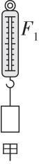
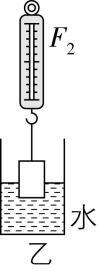
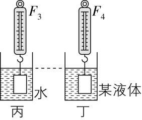

# Physics - 题目 1474

**ID**: ecf22fa9bb334e63a0112923f0240063
**年级**: Grade 8
**难度**: Medium
**题型**: Experiment

## 题目
如图是小青“探究浮力大小跟哪些因素有关”的实验，弹簧测力计示数的大小关系是： ${F}_{1}>{F}_{2}>{F}_{3}$ 。​​​​​​​‌（1） 图乙中物块所受浮力大小的表达式 ${F}_{浮乙}=$；（2） 小青比较乙、丙两图，得出浮力大小与深度有关的结论，有同学指出这个结论不可靠，原因是；（3） 如果水的密度大于图丁中某液体的密度，则弹簧测力计示数大小关系应满足 ${F}_{3}$（填“大于”“等于”或“小于”） ${F}_{4}$ 。

## 解答

1. （1） 由图甲可知，物块的重力 $G={F}_{1}$ ，图乙中弹簧测力计对物块的拉力大小为 ${F}_{2}$ ，根据称重法可知，物块所受浮力大小的表达式 ${F}_{浮乙}={F}_{1}-{F}_{2}$ ；
2. （2） 比较乙、丙两图可知，液体的密度不变，物块排开液体的体积和所处深度不同，由于没有控制物块排开液体的体积相同，所以不能探究浮力大小与深度的关系；
3. （3） 丙、丁两图物块浸没在液体中，排开液体的体积相同，由于 ${\rho }_{水}>{\rho }_{液}$ ，根据 ${F}_{浮}={\rho }_{液}g{V}_{排}$ 可知， ${F}_{浮水}>{F}_{浮液}$ ，根据 ${F}_{浮}=G-{F}_{拉}$ 可知，物块在水中受到的浮力： ${F}_{浮水}={F}_{1}-{F}_{3}$ ，物块在某液体中受到的浮力： ${F}_{浮液}={F}_{1}-{F}_{4}$ ，则 ${F}_{1}-{F}_{3}>{F}_{1}-{F}_{4}$ ，因此 ${F}_{3}$ 小于 ${F}_{4}$ 。

## 知识点

**中文**:
  - 实验探究阿基米德原理

**English**:
  - Experiment: Investigating Archimedes' Principle

---
