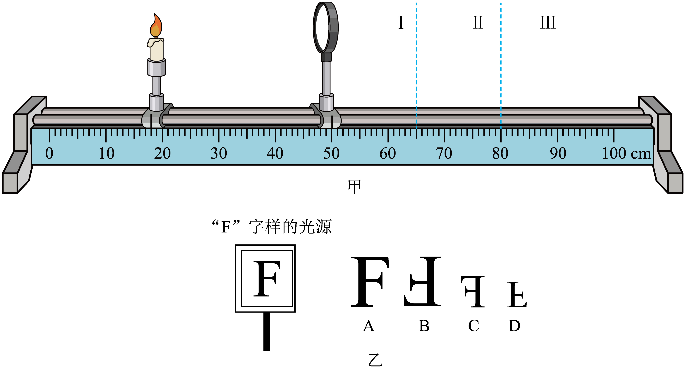

# Physics - 题目 960

**ID**: edc75296a4ca438a8da7a1579d8f35dc
**年级**: Grade 8
**难度**: Medium
**题型**: Experiment

## 题目
小梁在做“探究凸透镜成像规律”的实验时，所使用的凸透镜焦距是15cm。​​​​​​​‌（1）将光具座上蜡烛烛焰的中心、透镜的光心、光屏的中心（未画出）调节在同一高度，其目的是使像成在；（2）当把凸透镜固定在50cm刻度线位置，蜡烛固定在18cm刻度线位置时，光屏应在（选填“Ⅰ”“Ⅱ”或“Ⅲ”）区域内左右移动，才能在光屏上得到清晰的像。若得到清晰的像后，只将光屏和蜡烛的位置对调，则像的大小将（选填“变大”“变小”或“不变”）；（3）当凸透镜成实像时，物距增大，像距会（选填“增大”“减小”或“不变”）；当光屏上的像清晰时，小梁把自己的近视眼镜放在凸透镜和蜡烛之间，光屏上的像变得模糊不清，他应该向（选填“靠近”或“远离”）凸透镜的方向移动光屏，可再次得到清晰的像；（4）蜡烛逐渐燃烧变短时，光屏上烛焰的像随之（选填“上升”“下降”或“不变”）；（5）小梁用图乙所示的LED发光灯制成的“F”字样的光源代替蜡烛，放在光具座上某一位置，移动光屏又一次看到了清晰的像，该像可能是图乙中的（选填“A”“B”“C”或“D”）图。

## 解答

1. （1）过光心的光线传播方向不变，为了使像呈现在光屏的中央，应调节蜡烛烛焰的中心、透镜的光心、光屏的中心在同一高度。
2. （2）如图所示，物距为
3. $u=50.0{\rm{c}}{\rm{m}}-18.0{\rm{c}}{\rm{m}}=32.0{\rm{c}}{\rm{m}}>2f$
4. 根据凸透镜成像的规律，此时像距在1倍焦距与2倍焦距之间，则像距为15.0~30.0cm之间，故光屏应在Ⅱ区域内左右移，当像清晰后应为倒立缩小的实像；根据光路的可逆性，如果只将光屏和蜡烛的位置对调，即像距与物距对调后，像距大于物距，所成的像为倒立放大的实像，则像的大小将变大。
5. （3）根据凸透镜成像的规律，当凸透镜成实像时，物距增大，即物体远离凸透镜，像则靠近凸透镜，即像距会减小。
6. 近视眼镜是凹透镜制成的，对光线有发散作用，放在凸透镜和蜡烛之间，物距不变时，像距会变大，应该向远离凸透镜的方向移动光屏，可再次得到清晰的像。
7. （4）过光心的光线传播方向不变，蜡烛逐渐燃烧变短时，物向下移动，则像向上移动，故光屏上烛焰的像随之上升。
8. （5）根据凸透镜成像的规律，在光屏上可以承接的像是实像，即一定是倒立的，故B符合题意。

## 知识点

**中文**:
  - 凸透镜成像规律的探究实验

**English**:
  - Experiment: Imaging Rules of Convex Lenses

---
