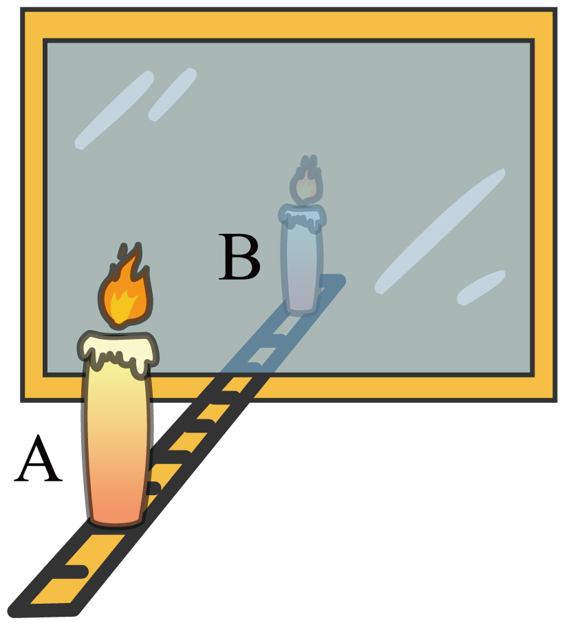

# Physics - 题目 576

**ID**: f15a38cb0c5542e39c135ba4c833b3d3
**年级**: Grade 8
**难度**: Medium
**题型**: Experiment

## 题目
小亮同学在做“平面镜成像”实验时， 将一块玻璃板竖直架在一把直尺的上面，再取两段相同的蜡烛A和B一前一后竖放在直尺上，点燃玻璃板前的蜡烛A，进行观察，如图所示。​​​​​​​‌（1）实验中应选择（选填“较薄”或“较厚”）的玻璃板，用玻璃板代替平面镜进行实验的目的是。（2）两段相同的蜡烛是为了比较像与物的关系。调节蜡烛B的位置， 直到与蜡烛A的像完全重合， 此时蜡烛B的位置即为蜡烛A的像所在的位置。（3）移去后面的蜡烛B，并在其所在位置上放一光屏，则光屏上（选填“能”或“不能”）接收到蜡烛烛焰的像，所以平面镜所成的是（选填“实”或“虚”）像。（4）小亮同学测出某次蜡烛离平面镜的距离为8cm，则此时镜中的像离前面蜡烛距离为cm；接下来，他将前面蜡烛靠近平面镜 2cm，此时镜中的像（选填“变大”、“变小”或“不变”） 。（不考虑蜡烛烧短）

## 解答

1. （1）使用较厚的玻璃板在成像时容易出现两个像的重影，不利于观察，为了避免这样的现象，便于观察，应该选择较薄的玻璃板。
2. 平面镜不透光，用玻璃板来代替平面镜，既能透光又能反射光使物体成像，能看到前面物体在玻璃板后面成的像，也能看到玻璃板后面的物体，便于确定像的位置。
3. （2）选取两个相同的蜡烛可以对像与物的大小进行比较，所以是为了比较像与物的大小关系。
4. （3）平面镜成的像是反射光线的反向延长线的交点，不是真实的光线会聚得到的像，所以是虚像，不能用光屏承接，所以不能接收到蜡烛烛焰的像。
5. （4）平面镜成像时，像与物到平面镜的距离为相等，蜡烛到平面镜的距离为8cm，像到平面镜的距离也是8cm，则此时像离前面蜡烛的距离为16cm。
6. 平面镜成像时，像的大小等于物体的大小，改变物距的大小，像的大小不变。

## 知识点

**中文**:
  - 平面镜成像特点的探究实验

**English**:
  - Experiment: Characteristics of Plane Mirror Imaging

---
