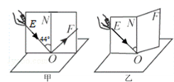

# Physics - 题目 2132

**ID**: f49c0f4451f841ddb2a7458c1b500db7
**年级**: Grade 8
**难度**: Medium
**题型**: Experiment

## 题目
小明用图示装置探究“光的反射定律”.​​​​​​​‌（1）图甲中反射角是度.（2）图甲中当入射角变大时，反射光线（偏离/靠拢）法线.（3）如图乙所示，将纸板NOF向后折，在纸板NOF上（能/不能）看到反射光线，此时（不存在/仍存在）反射光线，这样做的目的是．

## 解答

1. （1）由图知EO是入射光线，则OF是反射光线．入射角为44°，由于反射角等于入射角，所以反射角为44°；
2. （2）当入射光线向法线偏离时，反射光线与法线的夹角变大，所以入射角变大，此时反射角也变大，反射光线将偏离法线；
3. （3）因为反射光线、入射光线和法线在同一平面内，所以在实验过程中，将纸板向前或向后折，此时在纸板NOF上将不能看到反射光线，此时仍存在反射光线．

## 知识点

**中文**:
  - 探究光的反射定律

**English**:
  - Investigation: Law of Reflection

---
