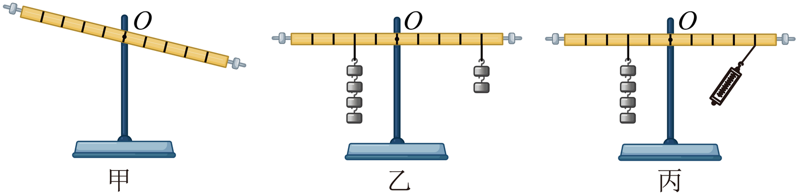

# Physics - 题目 2674

**ID**: f742e4da9f2a43fd8c7cc5296b310eb2
**年级**: Grade 8
**难度**: Medium
**题型**: Experiment

## 题目
小明用图甲所示的装置探究杠杆的平衡条件，其中杠杆的刻度均匀，每小格为5cm，每个钩码的重力均为0.5N。​​​​​​​‌（1）如图甲所示，此时杠杆保持静止，则杠杆处于（选填“平衡”或“非平衡”）状态；为使杠杆在水平位置平衡，应该向调节平衡螺母。（2）如图乙所示，实验中小明在杠杆两侧挂上数量不同的钩码并移动钩码的位置，使杠杆在水平位置平衡，小明进行了3次实验，实验数据记录如下表。分析实验数据，可归纳出杠杆的平衡条件是（用表格中的物理量符号表示）。多次测量的目的是。实验序号动力 $F{{}_{1}}/{\rm{N}}$动力臂 $L{{}_{1}}/{\rm{c}}{\rm{m}}$阻力 $F{{}_{2}}/{\rm{N}}$阻力臂 $L{{}_{2}}/{\rm{c}}{\rm{m}}$121012021.510353220410（3）如图乙所示，若在左右两边各加一个钩码，则杠杆将（选填“左端下沉”“右端下沉”或“保持水平”）。（4）如图丙所示，将弹簧测力计从图示位置变成竖直位置，杠杆始终保持水平位置平衡，弹簧测力计的示数会（选填“增大”“减小”或“不变”），说明力臂（选填“一定”或“不一定”）在杠杆上。

## 解答

1. （1）杠杆保持静止或者匀速转动，杠杆都是平衡状态。
2. 杠杆右倾，应向左调节平衡螺母。
3. （2）由表格中数据可知，杠杆平衡时有 $F{{}_{1}}L{{}_{1}}=F{{}_{2}}L{{}_{2}}$ ，则杠杆平衡条件是 $F{{}_{1}}L{{}_{1}}=F{{}_{2}}L{{}_{2}}$ 。
4. 多次测量可以避免偶然性，使结论更可靠。
5. （3）若在左右两边各加一个钩码，则等式左侧为 $\left ({F{{}_{1}}+G}\right )L{{}_{1}}=F{{}_{1}}L{{}_{1}}+GL{{}_{1}}$
6. 等式右侧 $\left ({F{{}_{2}}+G}\right )L{{}_{2}}=F{{}_{2}}L{{}_{2}}+GL{{}_{2}}$
7. 由于 $GL{{}_{1}}<GL{{}_{2}}$
8. 则 $\left ({F{{}_{1}}+G}\right )L{{}_{1}}<\left ({F{{}_{2}}+G}\right )L{{}_{2}}$
9. 此时杠杆不能平衡，向右侧下沉。
10. （4）拉力F向左倾斜位置转向竖直方向，此时F的力臂变大，根据杠杆的平衡条件，力变小，向左倾斜时，力臂不是力的作用点到支点的距离，力臂不在杠杆上，竖直位置时，力臂在杠杆上，所以力臂不一定在杠杆上。

## 知识点

**中文**:
  - 探究杠杆的平衡条件实验

**English**:
  - Experiment: Equilibrium Conditions of Levers

---
