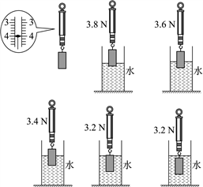
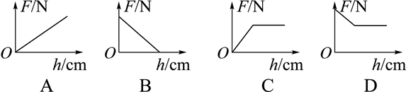

# Physics - 题目 1672

**ID**: fb9d0044685145bf9d3a6adf7ec8c50c
**年级**: Grade 8
**难度**: Medium
**题型**: Experiment

## 题目
小明想“探究浮力大小与深度的关系”，探究过程及有关数据如图所示．(1)物体(圆柱体)所受的重力是N．(2)物体受到的最大浮力是N．(3)下面四个图象中正确反映弹簧测力计示数F和物体下表面在水中的深度h关系的图象是．(物体未接触容器底)​​​​​​​‌

## 解答

1. （1）由图所示，物体在空气中的弹簧测力计示数为4N，则物体所受重力为4N；
2. （2）物体受到的浮力大小，利用称重法，F_{浮}=G-F′，可以看出当F′等于3.2N时，浮力最大，F_{浮}=0.8N；
3. （3）从弹簧秤示数可以看出，力F逐渐减小，到3.2N不变，所以F和物体下表面在水中的深度h关系的图象为D选项．

## 知识点

**中文**:
  - 探究影响浮力大小因素的实验

**English**:
  - Experiment: Factors Affecting Buoyancy

---
