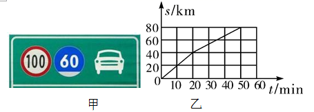

# Physics - 题目 70

**ID**: 0773f24323d34b8c87d46ff7fe595e1e
**年级**: Grade 8
**难度**: Medium
**题型**: Fill-in-the-blank

## 题目
小明家在我国广阔的平原地区，爸爸驾驶汽车行驶在高速公路上，见到如图甲限速标志牌，表示该车型行驶车速应保持在60－100（填单位）之间，图乙是爸爸在某段理想平直公路上行驶时记录数据的s－t图像，汽车在20min～50min时间段内汽车做（选填“匀速”或“变速”）运动，该段时间汽车的行驶速度是。​​​​​​​‌

## 解答

1. 表示该车型行驶车速应保持在60—100km/h。
2. 汽车在20min～50min时间段路程与时间的图像是一条倾斜的直线，故是匀速直线运动。
3. 该段时间汽车的行驶速度是
4. $v=\frac {s}{t}{\rm{=}}\frac {80{\rm{k}}{\rm{m}}{\rm{-}}{\rm{4}}{\rm{0}}{\rm{k}}{\rm{m}}}{50{\rm \min }{\rm{-}}20{\rm \min }}{\rm{=}}\frac {40{\rm{k}}{\rm{m}}}{0{\rm{.}}5{\rm{h}}}{\rm{=}}80{\rm{k}}{\rm{m}}/{\rm{h}}$
5. 故该段时间汽车的行驶速度是 $80{\rm{k}}{\rm{m}}/{\rm{h}}$ 。

## 知识点

**中文**:
  - 速度公式及其应用
  - 速度的定义及其单位
  - 速度的图像问题

**English**:
  - Velocity Formula and Applications
  - Definition and Units of Velocity
  - Velocity-Time Graphs

---
