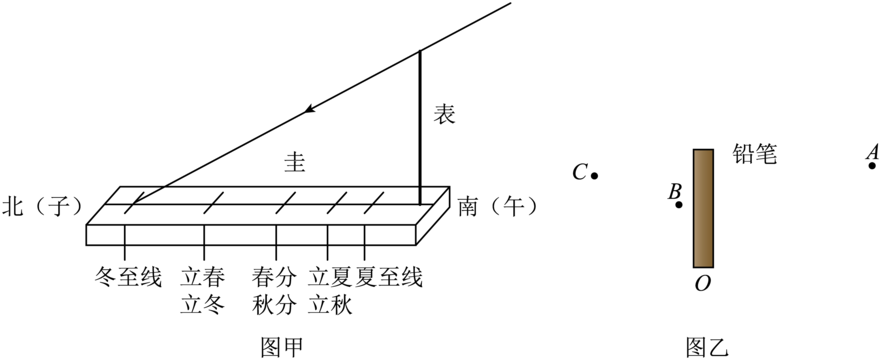

# Physics - 题目 1788

**ID**: 0c8bccf2d8774d4f9faead8410436698
**年级**: Grade 8
**难度**: Medium
**题型**: Fill-in-the-blank

## 题目
今年国庆节，乌鲁木齐市的小明带领学习小组成员，将自制的圭表放在太阳光下的水平地面上，用来研究一天中影子随时间变化的规律。​​​​​​​‌（1）太阳（选填“是”或“不是”）光源；地球上的人类能够看到太阳，说明光的传播（选填“需要”或“不需要”）介质。太阳到地球的距离约 $1.5\times 10{^{11}}$ 米，光从太阳射到地球的时间约为秒；（2）今年“秋分”是9月23日，在同年国庆节的正午，表的影子顶端会在图甲中的“秋分”刻度的（选填“左”或“右”）端。（3）如图乙，A、B、C三点是小明同学在水平板上记录下的这一天三个不同时刻铅笔顶端的影子位置，其中B点在O点的（选填“东”“西”“南”或“北”）侧，OA是（选填“8:00”“12:00”或“16:00”）时铅笔的影子。

## 解答

1. （1）太阳自身能够发光，太阳属于光源；
2. 由于太空是真空，没有介质，地球上的人类能够看到太阳，说明光的传播不需要介质；
3. 光在空气中的传播速度 $v=3.0\times 10{^{8}}{\rm{m}}{\rm{/}}{\rm{s}}$ ，由 $v=\frac {s}{t}$ 可知，光从太阳射到地球的时间约 $t=\frac {s}{v}=\frac {1.5\times 10{^{11}}{\rm{m}}}{3.0\times 10{^{8}}{\rm{m}}{\rm{/}}{\rm{s}}}=500{\rm{s}}$
4. （2）国庆节的日期在秋分之后，根据地理知识可知，太阳的直射角变小，表的正午影子比秋分的长，所以此时表的影子顶端在圭上刻度在秋分的左端；
5. （3）乌鲁木齐市位于北半球，一天中，太阳从东方升起，西方落下，上午物体的影子朝向西方，下午朝向东方。B点的影子相对更短，接近正午，正午时太阳在正南方向，影子朝向正北，所以B点在O点的北侧。
6. 由于光在空气中是沿直线传播的，下午，当太阳在铅笔的西侧时，铅笔的影子应该在东侧，所以OA是16:00时铅笔的影子。

## 知识点

**中文**:
  - 光沿直线传播的应用
  - 光源
  - 速度公式及其应用

**English**:
  - Applications of Rectilinear Propagation
  - Light Sources
  - Velocity Formula and Applications

---
