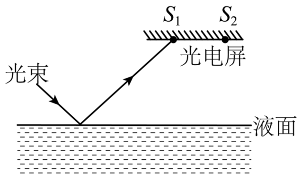

# Physics - 题目 2192

**ID**: 1109b2e16f4842c59ce668f211338655
**年级**: Grade 8
**难度**: Medium
**题型**: Fill-in-the-blank

## 题目
有一光电控制液面高度的仪器，通过光束在液面上的反射光线打到光电屏上来显示液面高度，光路图如图所示。​​​​​​​‌若此时入射光束与液面的夹角是50°，则反射角的大小是。；当入射光方向不变，光屏上的点由S_{1}移到S_{2}时，表示液面（选填“上升”、“下降”或“不变”）。

## 解答

1. [1]入射光束与液面的夹角是50°，则入射角为
2. $90{}^\circ -50{}^\circ =40{}^\circ $
3. 在光的反射中，反射角等于入射角，则反射角的大小是40°。
4. [2]由于入射光线是固定的，且光在液面上发生的是镜面反射，当液面发生变化时，反射光线的方向与原来的反射光线是平行的，如图
5. 
6. 由图可知，当光电屏上的点由S_{1}移到S_{2}时，液面下降。

## 知识点

**中文**:
  - 光的反射定律及其应用

**English**:
  - Law of Reflection and Applications

---
