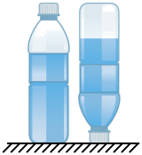

# Physics - 题目 1416

**ID**: 1887f0d54a9f41ce8c792f9c1e5bf88b
**年级**: Grade 8
**难度**: Medium
**题型**: Fill-in-the-blank

## 题目
将未装满水且密闭的矿泉水瓶，先正立放置在水平桌面上，再倒立放置，如图所示。​​​​​​​‌两次放置时，水对瓶底和瓶盖的压强分别为p_{A}p_{B}，水对瓶底和瓶盖的压力分别为F_{A}F_{B}（填“大于”.“小于”或“等于”）。

## 解答

1. 图中矿泉水瓶倒立放置时液体的深度较大，根据p=ρgh可知水对瓶底和瓶盖的压强大小关系为p_{A}小于p_{B}。
2. 正放时，瓶子内部水（柱体）对瓶子底部的压力大小等于其重力大小；根据 $p=\frac {F}{S}$ 可知倒放时水对瓶盖的压力大小为F=pS_{瓶盖}=ρghS_{瓶盖}=ρVg=mg
3. 即此时水对瓶盖的压力大小等于与瓶盖底面积等大、以瓶子内液体的深度为高的圆柱形液柱的重力，故水对瓶盖的压力小于瓶子内水的重力，故F_{A}大于F_{B}。

## 知识点

**中文**:
  - 压强的计算
  - 液体压强的大小及其计算

**English**:
  - Calculation of Pressure
  - Magnitude and Calculation of Liquid Pressure

---
