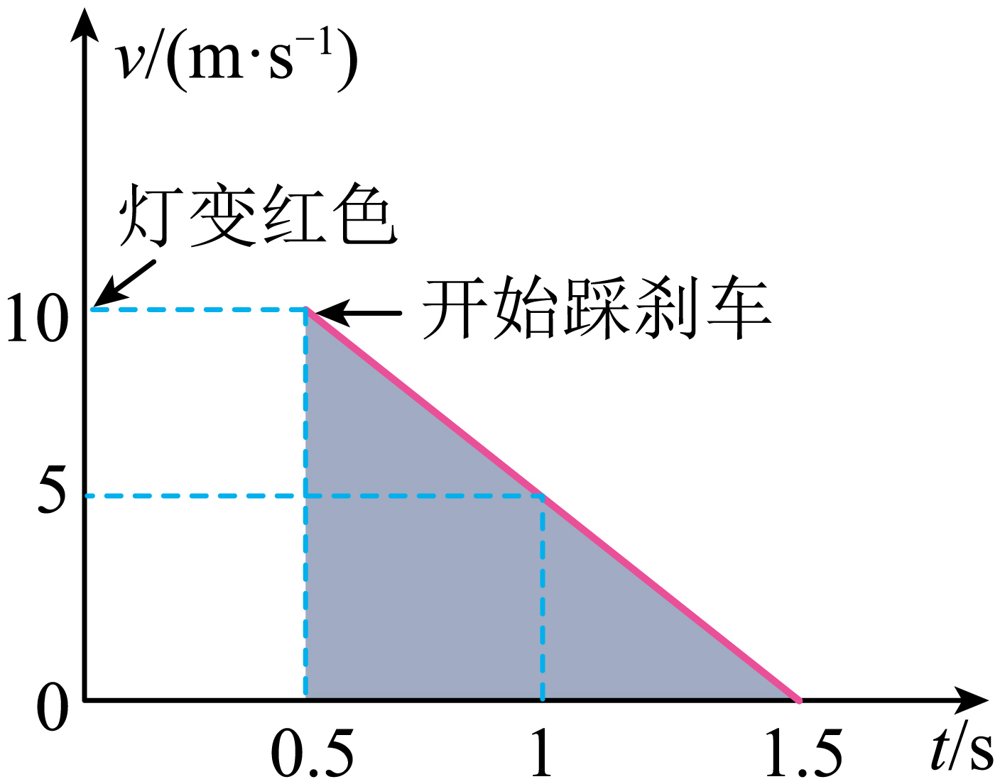

# Physics - 题目 441

**ID**: 18b315ecf8264115b8a7b05c63113285
**年级**: Grade 8
**难度**: Medium
**题型**: Fill-in-the-blank

## 题目
汽车在公路上匀速行驶，驾驶员发现前方路口信号灯转为红色，经一定反应时间后开始踩刹车，汽车车速 $v$ 随时间 $t$ 的变化关系如图所示。​​​​​​​‌由图可知在反应时间内汽车驶过的距离为m，在刹车时间内汽车驶过的距离为m，那么在刹车时间内汽车的平均速度为${\rm{m}}/{\rm{s}}$ ；若驾驶员饮酒，从发现信号灯转为红色到汽车完全停止共前进了15m，驾驶员驾驶汽车的行驶速度以及刹车距离不变，则驾驶员饮酒时的反应时间为s。

## 解答

1. 由图可知，在反应时间内汽车驶过的距离为 $s=vt=10{\rm{m}}/{\rm{s}}\times 0.5{\rm{s}}=5{\rm{m}}$ ，
2. 由图可知，刹车距离为 $s{{}_{1}}=\frac {10\times \left ({1.5-0.5}\right )}{2}{\rm{m}}=5{\rm{m}}$ ，
3. 从开始刹车到刹停，刹车时间为 $t{{}_{2}}=t{{}_{1}}-t=1.5{\rm{s}}-0.5{\rm{s}}=1{\rm{s}}$ ，
4. 汽车的平均速度为 $v{{}_{1}}=\frac {s{{}_{1}}}{t{{}_{2}}}=\frac {5{\rm{m}}}{1{\rm{s}}}=5{\rm{m}}/{\rm{s}}$ ，
5. 若驾驶员饮酒，从发现信号灯转为红色到汽车完全停止共前进了15m，驾驶员驾驶汽车的行驶速度以及刹车距离不变，则反应距离为 $s{{}_{2}}=s-s{{}_{1}}=15{\rm{m}}-5{\rm{m}}=10{\rm{m}}$ ，
6. 驾驶员饮酒时的反应时间为 $t{{}_{3}}=\frac {s{{}_{2}}}{v}=\frac {10{\rm{m}}}{10{\rm{m}}/{\rm{s}}}=1{\rm{s}}$ 。

## 知识点

**中文**:
  - 平均速度及其计算
  - 速度公式及其应用
  - 速度的图像问题

**English**:
  - Average Velocity and Calculation
  - Velocity Formula and Applications
  - Velocity-Time Graphs

---
