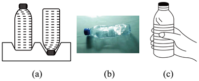

# Physics - 题目 2478

**ID**: 26e17e137173493fa3165c2318a59568
**年级**: Grade 8
**难度**: Medium
**题型**: Fill-in-the-blank

## 题目
小文用矿泉水瓶做实验：（1）他将两个相同的矿泉水瓶竖直放在海绵上，如图（a）所示，是为了探究压力的作用效果与的关系；（2）他在空矿泉水瓶中装入少量热水，迅速倒出，再马上盖上瓶盖看到瓶子变瘪了，如图（b）所示，验证的是的存在；（3）如图（c）他用手握住瓶子使瓶身竖直在空中静止不动，瓶子受到的摩擦力方竖直向（填“上”或“下”）；增大手对瓶子的握力，瓶子受到的摩擦力将（填“增大”“减小”或“不变”）。​​​​​​​‌

## 解答

1. （2）[2]如图b，在空矿泉水瓶中装入少量热水，迅速倒出热水，瓶内气体温度高，当封住瓶盖，瓶内温度降低，水蒸气液化时，瓶内气压减小，瓶外大气压大于瓶内气压，把瓶子压瘪，验证的是大气压的存在。
2. （3）[3]瓶身竖直在空中静止不动，处于平衡状态，瓶子受到的摩擦力与重力为一对平衡力，大小相等，方向相反，因重力的方向竖直向下，故摩擦力方竖直向上。
3. [4]增大手对瓶子的握力，瓶仍处于静止状态，摩擦力与重力为一对平衡力，瓶子受到的摩擦力大小仍等于重力大小，摩擦力将不变。

## 知识点

**中文**:
  - 大气压强的存在实验
  - 静摩擦力大小的影响因素
  - 静摩擦力的方向
  - 探究影响压力作用效果因素的实验

**English**:
  - Experiment: Existence of Atmospheric Pressure
  - Factors Affecting Static Friction
  - Direction of Static Friction
  - Experiment: Factors Affecting Pressure Effect

---
