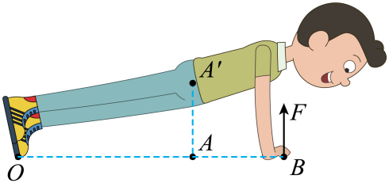

# Physics - 题目 1224

**ID**: 2c174944866344c1902f40c91b4b2112
**年级**: Grade 8
**难度**: Medium
**题型**: Fill-in-the-blank

## 题目
如图所示是小高在体育课上做俯卧撑时的场景，若小高的质量为60kg，若将他的身体看作为杠杆，OA=0.8m，AB=0.4m，则地面对手掌的支持力为N，若该同学在1分钟内做了40个俯卧撑，每个俯卧撑重心上升20cm，则他做俯卧撑r功率为W。​​​​​​​‌画出地面对手掌支持力的力臂l。 （g=10N/kg）

## 解答

1. 该同学的重力G=mg=60kg×10N/kg=600N，由图可知动力臂OB=OA+AB=0.8m+0.4m=1.2m，由杠杆平衡条件可得F∙OB=G∙OA，则 $F=\frac {G\cdot OA}{OB}=\frac {600{\rm{N}}\times 0.8{\rm{m}}}{1.2{\rm{m}}}=400{\rm{N}}$ ，该同学做了40个俯卧撑克服重力所做的功W=nGh=40×600N×0.2m=4800J，则他做俯卧撑的功率 $P=\frac {W}{t}=\frac {4800{\rm{J}}}{60{\rm{s}}}=80{\rm{W}}$ ，由图可知，支点为O，连接OB为支撑力对应的力臂，如图所示：
2. 

## 知识点

**中文**:
  - 功率的计算和估算
  - 重力公式的应用
  - 杠杆平衡条件的应用

**English**:
  - Calculation and Estimation of Power
  - Application of Gravity Formula
  - Application of Lever Equilibrium Conditions

---
