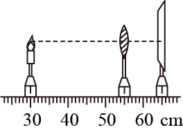

# Physics - 题目 305

**ID**: 2dee321595844b53989936bb00a6cefc
**年级**: Grade 8
**难度**: Medium
**题型**: Fill-in-the-blank

## 题目
如图是探究凸透镜成像的实验装置，光屏上得到了一个清晰的像（光屏上像未给出），则该像为、的实像，应用这一规律可以制成（选填“照相机”或“投影仪”），保持透镜不动，将蜡烛向左移动，为使光屏上再次出现清晰的像，应将光屏向移动（选填“左”或“右”）。​​​​​​​‌

## 解答

1. 如图物距u=25cm，像距是v=10cm，u＞v，由凸透镜成像规律可得，此时凸透镜成倒立、缩小的实像，应用于照相机。
2. 根据凸透镜成实像时，“物远像近像变小”的特点，将蜡烛向左移动，物距增大，为使光屏上再次出现清晰的像，像距要减小，所以将光屏向左移动。

## 知识点

**中文**:
  - 凸透镜成像规律的应用

**English**:
  - Applications of Convex Lens Imaging

---
