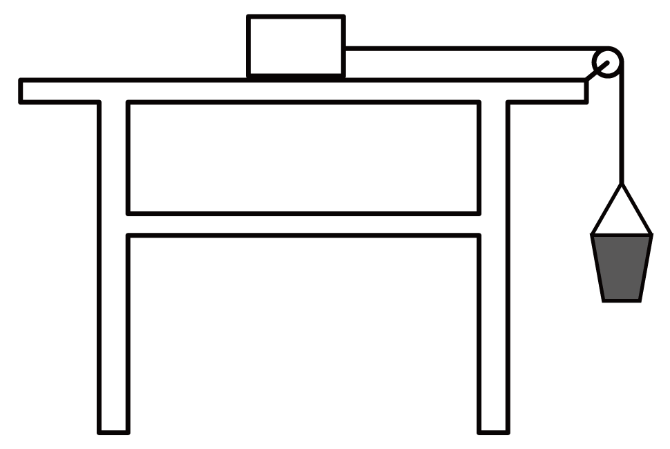

# Physics - 题目 907

**ID**: 328a0042b87d4440b6ed3ed8e2d89473
**年级**: Grade 8
**难度**: Medium
**题型**: Fill-in-the-blank

## 题目
如图所示，小桶质量为500g时，物块恰好做匀速直线运动（忽略细线与滑轮之间的摩擦），此时物块受到的滑动摩擦力大小为，方向为，继续向沙桶中加入沙子，物块受到的滑动摩擦力大小（选填“变大”“变小”或“不变”），方向。​​​​​​​‌（选填“改变”或“不变”）（g取10N/kg）

## 解答

1. [1]物块恰好做匀速直线运动，处于平衡状态，向右拉力与摩擦力是一对平衡力，故摩擦力等于向右拉力，通过定滑轮，拉力大小等于小桶的重力，所以滑动摩擦力为
2. $f=F=G=mg=500\times 10{^{-3}}{\rm{k}}{\rm{g}}\times 10{\rm{N}}/{\rm{k}}{\rm{g}}=5{\rm{N}}$
3. [2]摩擦力总是阻碍物体的相对运动，物块向右匀速运动，所以摩擦力方向向左。
4. [3]影响滑动摩擦的因素是接触面的粗糙程度和对接触面的压力大小。向桶中加入沙子，改变了拉力的大小，而木块对桌面的压力和接触面的粗超程度没变，所以摩擦力大小不变。
5. [4]加入沙子后，物块仍然向右运动，滑动摩擦力的方向不变，仍然向左。

## 知识点

**中文**:
  - 二力平衡的条件及其应用

**English**:
  - Conditions and Applications of Two-Force Equilibrium

---
