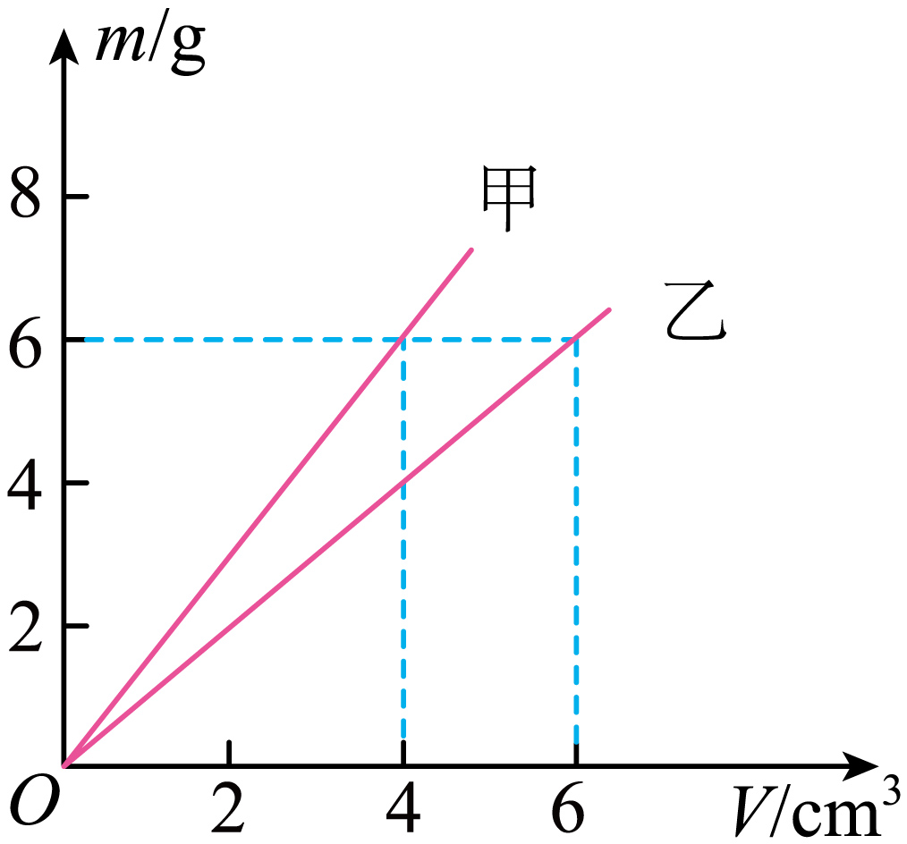

# Physics - 题目 945

**ID**: 379aabb000634de89ba17c8c995e3274
**年级**: Grade 8
**难度**: Medium
**题型**: Fill-in-the-blank

## 题目
如图所示是相同条件下，探究甲、乙两种液体的质量与体积的关系图象。​​​​​​​‌由图象可知，同种液体的质量与体积成（选填“正比”或“反比”），甲液体的密度是kg/m^{3}，相同体积的甲、乙两种液体的质量之比是。

## 解答

1. 由图象可知，甲、乙两种液体的质量与体积的关系图象为正比例函数图象，即同种液体的质量与体积成正比。
2. 对于甲物质，当体积是4cm^{3}时，质量为6g，所以其密度为 $ρ{{}_{甲}}{\rm{=}}\frac {m{{}_{甲}}}{V{{}_{甲}}}{\rm{=}}\frac {{\rm{6}}{\rm{g}}}{{\rm{4}}{\rm{c}}{\rm{m}}{\rm{3}}}{\rm{=}}{\rm{1}}{\rm{.}}{\rm{5}}{\rm{g}}{\rm{/}}{\rm{c}}{\rm{m}}{\rm{=}}{\rm{1}}{\rm{.}}{\rm{5}}\times {\rm{1}}{\rm{0}}{^{{\rm{3}}}}{\rm{k}}{\rm{g}}{\rm{/}}{\rm{m}}{^{{\rm{3}}}}$
3. 对于乙物质，当体积是6cm^{3}时，质量为6g，所以其密度为 $ρ{{}_{乙}}{\rm{=}}\frac {m{{}_{乙}}}{V{{}_{乙}}}{\rm{=}}\frac {{\rm{6}}{\rm{g}}}{{\rm{6}}{\rm{c}}{\rm{m}}{\rm{3}}}{\rm{=}}{\rm{1}}{\rm{.}}{\rm{0}}{\rm{g}}{\rm{/}}{\rm{c}}{\rm{m}}{\rm{=}}{\rm{1}}{\rm{.}}{\rm{0}}\times {\rm{1}}{\rm{0}}{^{{\rm{3}}}}{\rm{k}}{\rm{g}}{\rm{/}}{\rm{m}}{^{{\rm{3}}}}$ ，相同体积的甲、乙两种液体的质量之比m_{甲}′∶m_{乙}′=ρ_{甲}V∶ρ_{乙}V=ρ_{甲}∶ρ_{乙}=1.5×10^{3}kg/m^{3}∶1.0×10^{3}kg/m^{3}=3∶2

## 知识点

**中文**:
  - 密度公式的应用

**English**:
  - Application of Density Formula

---
