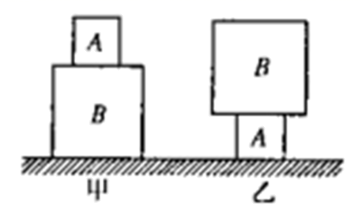

# Physics - 题目 1605

**ID**: 3c46ef94135e4084b559f6f8a3ba4ce3
**年级**: Grade 8
**难度**: Medium
**题型**: Fill-in-the-blank

## 题目
如图所示，正方体物块A、B密度均匀，其边长之比为1∶2，分别按甲、乙所示放在水平地面上，则两种放法对水平地面的压力之比是，压强之比是。​​​​​​​‌

## 解答

1. 将A、B看作一个整体，在甲、乙两种情况下，它们的总重相同，则对地面的压力相同，所以两种放法对水平地面的压力之比是1∶1。
2. 两种放法对水平地面的压强之比
3. $\frac {p{{}_{甲}}}{p{{}_{乙}}}=\frac {\frac {F{{}_{甲}}}{S{{}_{甲}}}}{\frac {F{{}_{乙}}}{S{{}_{乙}}}}=\frac {\frac {G{{}_{总}}}{S{{}_{甲}}}}{\frac {G{{}_{总}}}{S{{}_{乙}}}}=\frac {S{{}_{乙}}}{S{{}_{甲}}}=\frac {l{{}_{{\rm{A}}}^{2}}}{l{{}_{{\rm{B}}}^{2}}}=\frac {1{^{2}}}{2{^{2}}}=\frac {1}{4}$

## 知识点

**中文**:
  - 压力大小的比较
  - 压强大小的比较

**English**:
  - Comparing Magnitude of Pressure Force
  - Comparing Pressure

---
