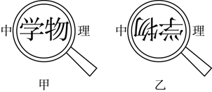

# Physics - 题目 2850

**ID**: 4e1e22ec77d14feda134797277d877cc
**年级**: Grade 8
**难度**: Medium
**题型**: Fill-in-the-blank

## 题目
如图是用一个凸透镜先后两次观察书本上的字的情景，根据你掌握的知识判断，图甲成的是像（选填“实”或“虚”）。​​​​​​​‌若甲图的物距为u_{甲}，乙图的物距为u_{乙}，它们的大小关系是u_{甲}（选填“大于”、“小于”或“等于”）u_{乙}。与图乙所反映的成像规律相同的光学仪器有。

## 解答

1. [1]图甲成的是一个正立放大的像，这时凸透镜相当于一个放大镜，所以成的是虚像。
2. [2]图甲的凸透镜相当于一个放大镜，物距在一倍焦距之内，即u_{甲}＜f，图乙成的是倒立放大的像，物距应该在一到二倍焦距之间，即f＜u_{乙}＜2f，所以它们的大小关系是u_{甲}小于u_{乙}。
3. [3]图乙物距应该在一到二倍焦距之间，成的是倒立放大的实像，所以与图乙所反映的成像规律相同的光学仪器有投影仪。

## 知识点

**中文**:
  - 凸透镜成像规律的应用
  - 实像与虚像
  - 生活中的透镜应用

**English**:
  - Applications of Convex Lens Imaging
  - Real and Virtual Images
  - Lenses in Daily Life

---
