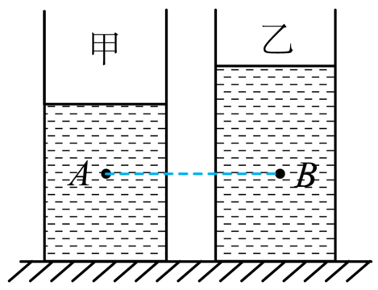

# Physics - 题目 1574

**ID**: 5091fe75ebe44c1798edcb34bc17d2d7
**年级**: Grade 8
**难度**: Medium
**题型**: Fill-in-the-blank

## 题目
如图所示，完全相同的圆柱形容器中，装有不同的两种液体甲、乙，在两容器中，距离容器底同一高度处分别有A、B两点。​​​​​​​‌若A、B两点的压强相等，则两种液体对容器底的压强关系是p_{甲}_p_{乙}；若两种液体的质量相等，则A、B两点的压强关系是p_{A}p_{B}（以上均选填“＞”、“＜”或“=”）。

## 解答

1. [1]因在两容器中同一高度A、B两点的压强相等，即
2. p_{A}=p_{B}
3. 由图可知，而且A所处的深度小
4. h_{A}＜h_{B}
5. 根据p=ρgh可得甲液体的密度大于乙液体的密度，即
6. ρ_{甲}＞ρ_{乙}
7. 以A、B两点向下的这部分液体作为研究对象，因为距离容器底的高度相同h。由p=ρgh可得，这部分液体对容器底的压强
8. ρ_{甲}gh＞ρ_{乙}gh
9. 即
10. p_{甲}^{′}＞p_{乙}^{′}
11. 甲液体对容器底的压强为
12. p_{甲}=p_{A}+p_{甲}^{′}
13. 乙液体对容器底的压强为
14. p_{乙}=p_{B}+p_{乙}^{′}
15. 综上可得，两种液体对容器底的压强关系
16. p_{甲}＞p_{乙}
17. [2]若两种液体的质量相等，且装在相同的容器中，由图可知
18. V_{甲}＜V_{乙}
19. 由 $ρ{\rm{=}}\frac {m}{V}$ 可得
20. ρ_{甲}^{′}＞ρ_{乙}^{′}
21. 液体对容器底部的压力等于自身重力，容器的底面积相同，根据 $p{\rm{=}}\frac {F}{S}$ 可知，容器底部受到液体的压强相同，即
22. p_{甲}^{′′}=p_{乙}^{′′}
23. 因A、B到容器底的距离相同，由p=ρgh可得，从A、B两点以下的液体对容器底的压强关系为
24. p_{A}_{下}＞p_{B}_{下}
25. 液体对容器底产生的压强为
26. p_{甲}^{′′}=p_{A}+p_{A}_{下}
27. p_{乙}^{′′}=p_{B}+p_{B}_{下}
28. 综上可得，A、B两点的压强关系是p_{A}＜p_{B}_{。}

## 知识点

**中文**:
  - 压强大小的比较
  - 密度公式的应用
  - 液体压强计算公式的应用

**English**:
  - Comparing Pressure
  - Application of Density Formula
  - Application of Liquid Pressure Formula

---
