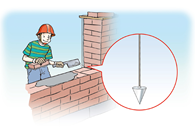

# Physics - 题目 2949

**ID**: 57b7861fbd0d46a79072b2cd14058023
**年级**: Grade 8
**难度**: Medium
**题型**: Fill-in-the-blank

## 题目
如图所示建筑工人在砌墙时常常在墙壁旁边挂一条铅垂线，当铅垂线下的重物静止时，细线对重物的拉力和重物受到的是一对平衡力，细线对重物的拉力的方向是的。​​​​​​​‌工人只要观察细线和墙壁是否就可以判断出墙壁是否竖直。

## 解答

1. [2]细线对重物的拉力和重物受到的重力是一对平衡力，大小相等，方向相反，重物的重力方向是竖直向下的，所以细线对重物的拉力的方向是竖直向上的。
2. [3]由于细线在竖直方向上，如果观察到细线和墙壁是平行的，就可以判断出墙壁是竖直的。

## 知识点

**中文**:
  - 二力平衡的概念及平衡状态的判断
  - 重力的方向

**English**:
  - Concept and Judgment of Equilibrium
  - Direction of Gravity

---
